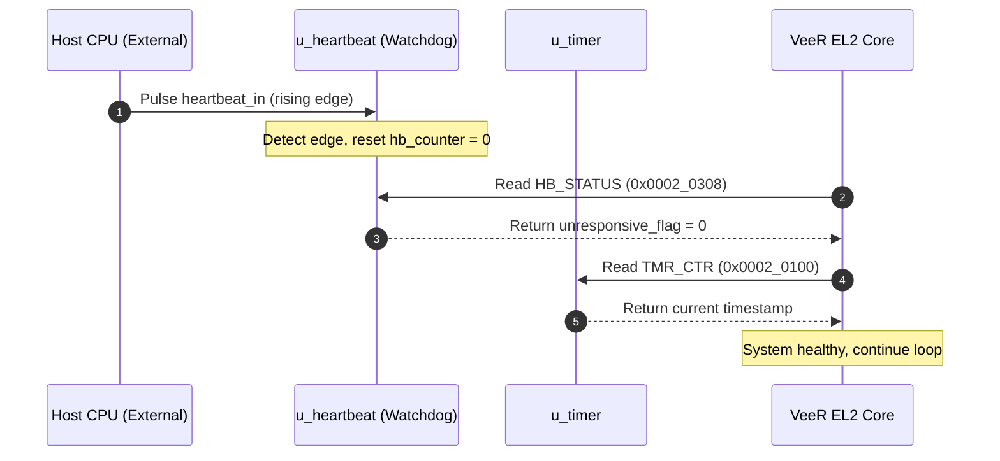
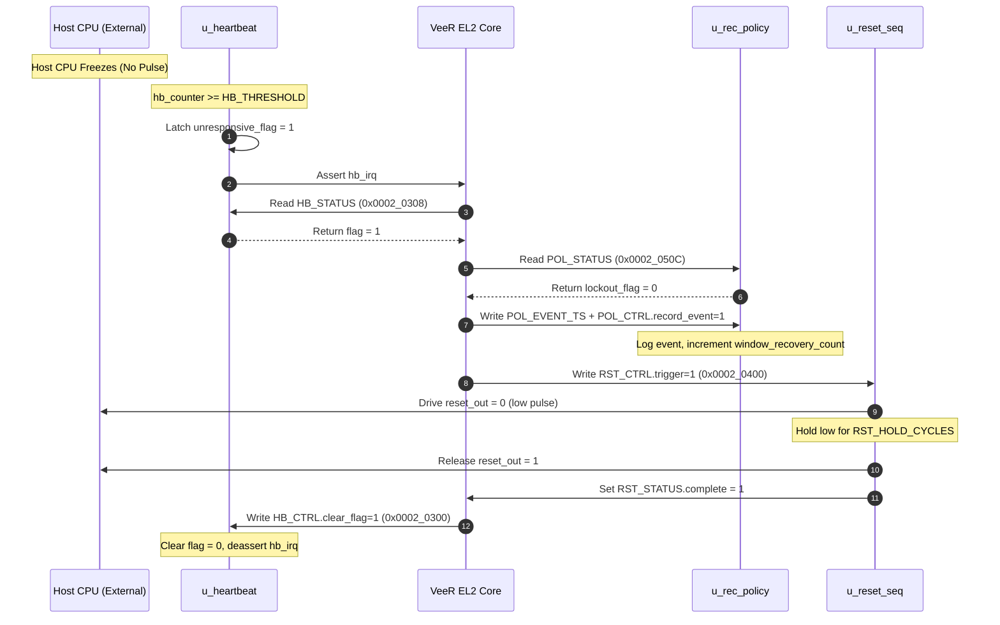
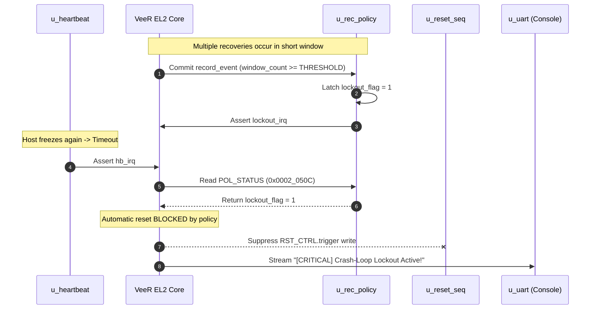
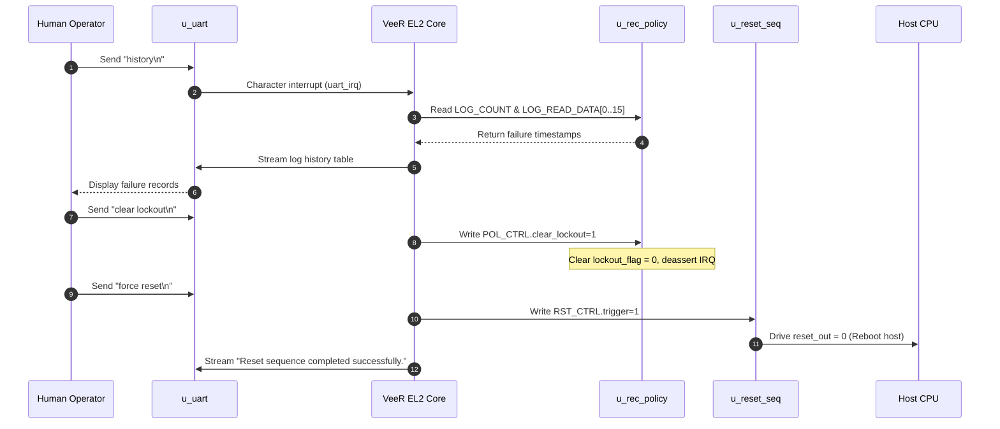
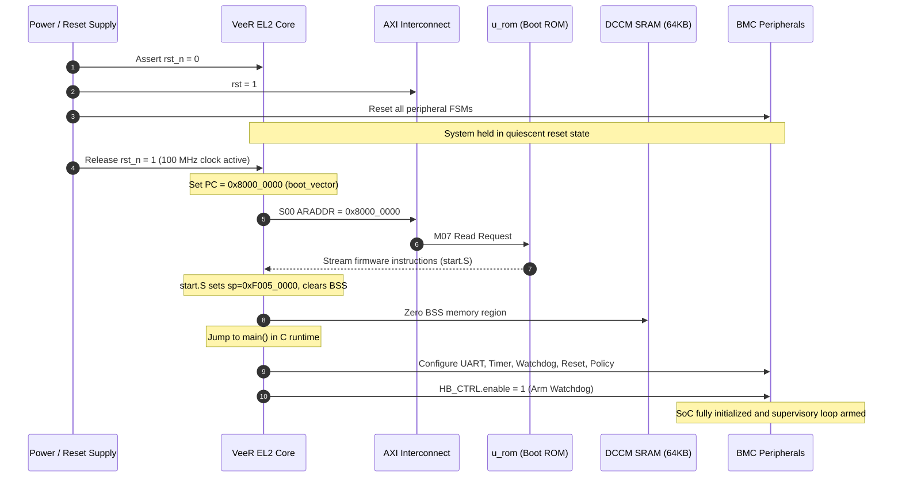

# End-to-End Control Path & Event Tracing

**Document ID:** `docs/arch/05_control_path.md`  
**Stage:** Stage 5 — Control Path, Event Tracing, Latency Characterization, and Sequence Diagrams  
**Target:** Honour SoC Verification Architecture & UVM Planning  
**Prior Reference:** Analyzed in accordance with [`docs/arch/01_inventory.md`](file:///home/student/sriv_183/honour_soc/docs/arch/01_inventory.md), [`docs/arch/02_blocks.md`](file:///home/student/sriv_183/honour_soc/docs/arch/02_blocks.md), [`docs/arch/03_bus_matrix.md`](file:///home/student/sriv_183/honour_soc/docs/arch/03_bus_matrix.md), and [`docs/arch/04_address_map.md`](file:///home/student/sriv_183/honour_soc/docs/arch/04_address_map.md)  

---

## 1. System Control and Event Signal Matrix

The table below catalogs every control, event, interrupt, and reset signal in the BMC SoC, detailing signal origin, destination, activation trigger, latency, and system effect.

| Signal Name | Source Block / Port | Destination Block / Port | Trigger Condition | Latency (Cycles) | Resulting Hardware / Software Action | Source Citation |
|---|---|---|---|---|---|---|
| `heartbeat_in` | External Pad `heartbeat_in` | `u_heartbeat.heartbeat_in` `u_gpio.heartbeat_in` | Rising edge pulse generated by external host CPU alive monitor. | 1 cycle (edge sample flop) | In `u_heartbeat`, resets `hb_counter` to 0. In `u_gpio`, updates `GPIO_STATUS[0]`. | `rtl/soc_top.v:1429, 1353` `tb/tb_heartbeat_monitor.v:177` |
| `hb_irq` | `u_heartbeat.hb_irq` | `u_veer.extintsrc_req[1]` | `hb_counter >= HB_THRESHOLD` while `enable == 1`. | 1 cycle (registered comparator match) | Asserts external interrupt line 1 to VeeR PIC controller; awakens CPU from sleep/polling loop. | `rtl/soc_top.v:1430, 1600` `tb/tb_heartbeat_monitor.v:268` |
| `unresponsive_flag` | `u_heartbeat.hb_unresponsive_flag` | `HB_STATUS[0]` (read by CPU via AXI) | `hb_counter >= HB_THRESHOLD`. | 1 cycle | Latches sticky bit in `HB_STATUS[0]`; remains 1 even if heartbeats resume until explicitly cleared by software. | `rtl/soc_top.v:1391` `tb/tb_heartbeat_monitor.v:240, 290` |
| `HB_CTRL.clear_flag` | Firmware AXI Write (`0x0002_0300`, bit 1) | `u_heartbeat` core | Software supervisory write after processing failure. | Handshake + 1 cycle (self-clearing) | Clears `hb_unresponsive_flag = 0` and deasserts `hb_irq = 0`. | `tb/tb_heartbeat_monitor.v:303-308` |
| `RST_CTRL.trigger` | Firmware AXI Write (`0x0002_0400`, bit 0) | `u_reset_seq` core | Software recovery command write while `in_progress == 0`. | Handshake + 1 cycle | Launches FSM into `ASSERT`, drives `reset_out = 1'b0`, clears `complete`, sets `in_progress = 1`. | `rtl/soc_top.v:1434` `tb/tb_reset_sequencer.v:5-8` |
| `reset_out` (`reset_out_internal`) | `u_reset_seq.reset_out` | External Pad `reset_out` `u_gpio.reset_out` | `rst_state == ASSERT`. | 0 cycles (direct register output) | Drives external active-low reset to host CPU motherboard power circuitry. | `rtl/soc_top.v:1471, 1475` `tb/tb_reset_sequencer.v:1` |
| `rst_complete` | `u_reset_seq.rst_complete` | `RST_STATUS[1]` (read by CPU via AXI) | `rst_countdown == 0` during active pulse. | 1 cycle upon countdown expiry | Sets sticky bit `RST_STATUS[1] = 1`, clears `in_progress = 0`, returns `reset_out = 1'b1`. | `rtl/soc_top.v:1436` `tb/tb_reset_sequencer.v:6` |
| `POL_CTRL.record_event` | Firmware AXI Write (`0x0002_0500`, bit 0) | `u_rec_policy` core | Software command written after launching recovery. | Handshake + 1 cycle (self-clearing) | Commits `staged_event_ts` to `log_buffer[log_wr_ptr]`, increments `log_wr_ptr`, `log_count`, and `window_recovery_count`. | `rtl/soc_top.v:1482` `tb/tb_recovery_policy.v:4-7` |
| `lockout_flag` | `u_rec_policy.lockout_flag` | `POL_STATUS[0]` (read by CPU via AXI) | `window_recovery_count >= POL_THRESHOLD`. | 1 cycle (registered comparator match) | Sticky flag blocking automatic firmware resets; asserts `lockout_irq = 1`. | `rtl/soc_top.v:1485` `tb/tb_recovery_policy.v:9-10` |
| `lockout_irq` | `u_rec_policy.lockout_irq` | `u_veer.extintsrc_req[3]` | `lockout_flag == 1`. | 1 cycle | Asserts external interrupt line 3 to VeeR PIC controller; signals severe crash-loop condition. | `rtl/soc_top.v:1524, 1600` |
| `POL_CTRL.clear_lockout` | Firmware AXI Write (`0x0002_0500`, bit 1) | `u_rec_policy` core | Operator console command via UART. | Handshake + 1 cycle (self-clearing) | Resets `lockout_flag = 0` and deasserts `lockout_irq = 0`. | `rtl/soc_top.v:1482` `tb/tb_recovery_policy.v:11` |
| `uart_irq` | `u_uart.read_interrupt_o` | `u_veer.extintsrc_req[0]` | RX FIFO reaches trigger level or character received with `IER[0] == 1`. | 1 cycle | Asserts external interrupt line 0 to VeeR PIC controller; signals console input waiting. | `rtl/soc_top.v:738, 1600` `axi_uart_top.v:110` |
| `vblank_irq` | `u_vga.vblank_irq` | `u_veer.extintsrc_req[2]` | VGA raster beam reaches line 480 (vertical blank porch). | 1 cycle | Asserts external interrupt line 2 to VeeR PIC controller; triggers buffer update window. | `rtl/soc_top.v:1572, 1600` |

---

## 2. End-to-End Operational Control Sequences

### 2.1 Scenario A: Normal Supervisory Operation
In normal operating mode, the host system pulses `heartbeat_in` periodically at intervals well within the configured threshold.

#### Step Sequence
1. External host CPU asserts a pulse on physical pin `heartbeat_in` (`soc_top.v:167`).
2. `u_heartbeat` samples rising edge via `hb_prev_sample` (`tb/tb_heartbeat_monitor.v:177`).
3. Hardware synchronously resets internal `hb_counter` to `32'd0` within 1 cycle.
4. Firmware supervisory loop running on VeeR core reads `u_timer` (`0x0002_0100`) and `HB_ELAPSED` (`0x0002_030C`) via AXI LSU.
5. Firmware verifies `HB_STATUS[0] == 0` (`unresponsive_flag == 0`).
6. System remains in steady state; no reset or interrupt is triggered.

---

### 2.2 Scenario B: Heartbeat Missed & Autonomous Recovery
The host system freezes, stopping pulses on `heartbeat_in`. Hardware detects timeout and triggers a controlled reset sequence.

#### Step Sequence
1. Host CPU freezes; no pulses appear on `heartbeat_in`.
2. `u_heartbeat` increments `hb_counter` on every clock cycle.
3. `hb_counter` exceeds `HB_THRESHOLD` (`tb/tb_heartbeat_monitor.v:262-264`).
4. `u_heartbeat` latches `hb_unresponsive_flag = 1` and asserts `hb_irq = 1` to VeeR core (`soc_top.v:1430, 1600`).
5. VeeR core ISR (or polling loop) detects timeout and reads `POL_STATUS` (`0x0002_050C`).
6. Core verifies `lockout_flag == 0`.
7. Core reads current timestamp from `u_timer` (`0x0002_0100`).
8. Core writes timestamp to `POL_EVENT_TS` (`0x0002_0510`) and triggers `POL_CTRL.record_event = 1` (`0x0002_0500`).
9. `u_rec_policy` stores timestamp in circular `log_buffer` and increments `window_recovery_count`.
10. Core configures reset pulse width via `RST_HOLD_CYCLES` (`0x0002_0404`).
11. Core writes `RST_CTRL.trigger = 1` (`0x0002_0400`).
12. `u_reset_seq` asserts `reset_out = 1'b0` for programmed duration (`tb/tb_reset_sequencer.v:5`).
13. `u_reset_seq` returns `reset_out = 1'b1` and sets `complete = 1`.
14. Core clears sticky watchdog fault by writing `HB_CTRL.clear_flag = 1` (`0x0002_0300`).

---

### 2.3 Scenario C: Repeated Failures & Crash-Loop Lockout
The host system restarts but crashes repeatedly upon boot, exceeding allowable recoveries per rolling window.

#### Step Sequence
1. Repeated recoveries increment `window_recovery_count` within active `POL_WINDOW`.
2. A new failure occurs; core logs recovery via `POL_CTRL.record_event = 1`.
3. `u_rec_policy` increments `window_recovery_count`, reaching `POL_THRESHOLD` (`tb/tb_recovery_policy.v:9-10`).
4. Internal comparator latches sticky `lockout_flag = 1` and asserts `lockout_irq = 1` (`soc_top.v:1524`).
5. Subsequent heartbeat timeout occurs.
6. Core reads `POL_STATUS[0]` and detects `lockout_flag == 1`.
7. **Lockout Enforcement**: Core suppresses write to `RST_CTRL.trigger`. Reset pulse is **blocked**.
8. Core streams high-priority critical telemetry message over UART: `[CRITICAL] Host in Crash-Loop! Automatic Reset Locked Out.`
9. Core updates `u_vga` character buffer with `LOCKOUT ACTIVE` text status.

---

### 2.4 Scenario D: Manual Lockout Clear & Operator Override
An operator connects to the serial console, inspects diagnostic history, and issues manual commands to clear lockout and force a reboot.

#### Step Sequence
1. Operator types `history` command into terminal console via `uart_rx`.
2. Core parses command and reads total log count from `LOG_COUNT` (`0x0002_051C`).
3. Core iterates `LOG_READ_IDX = 0..15`, reading each timestamp from `LOG_READ_DATA` (`0x0002_0518`), and prints history over UART.
4. Operator types `clear lockout` command.
5. Core writes `POL_CTRL.clear_lockout = 1` (`0x0002_0500`, bit 1) (`tb/tb_recovery_policy.v:11`).
6. `u_rec_policy` clears `lockout_flag = 0` and deasserts `lockout_irq = 0`.
7. Operator types `force reset` command.
8. Core writes `RST_CTRL.trigger = 1` (`0x0002_0400`).
9. `u_reset_seq` asserts `reset_out = 1'b0` for calibrated cycle duration.
10. Operator receives confirmation on terminal via `uart_tx`.

---

### 2.5 Scenario E: Power-On / Boot Reset Sequence
Cold power-on and reset release sequence initializing the entire SoC from Boot ROM.

#### Step Sequence
1. External system power stabilizes; top-level `clk` begins oscillating at 100 MHz.
2. Active-low power-on reset `rst_n` is held low for multiple clock cycles (`tb/tb_soc_core.v:38`).
3. Asynchronous reset asserts across all internal IP blocks:
   - `u_veer`: Core enters reset state (`rst_l = 0`, `dbg_rst_l = 0`).
   - `u_axi_intercon`: Synchronous reset `rst = ~rst_n` forces FSM to `STATE_IDLE`.
   - `u_heartbeat`: FSM forced to `DISABLED`, counters cleared to 0.
   - `u_reset_seq`: FSM forced to `IDLE`, output `reset_out = 1'b1` (deasserted).
   - `u_rec_policy`: Counters and pointers cleared to 0.
   - `u_vga`: Video engine disabled, RGB outputs forced to 0.
4. `rst_n` deasserts high synchronously to `clk`.
5. VeeR EL2 core releases reset and initializes PC to boot vector `boot_vector = 32'h8000_0000` (`rtl/soc_top.v:1584, 1590`).
6. Core IFU issues 64-bit AXI4 read burst (`s00_axi_araddr = 32'h8000_0000`) through crossbar to `u_rom` (`axi_rom`).
7. `u_rom` streams instructions from `firmware.hex` via `m07_axi_rdata`.
8. Firmware startup code in `firmware/start.S` executes:
   - Configures MRAC (CSR `0x7c0`) to designate peripheral window `0x0002_xxxx` as side-effect device memory (`firmware/start.S:10-11`).
   - Initializes Stack Pointer (`sp`) to top of DCCM SRAM (`0xF005_0000`) (`firmware/start.S:14`).
   - Zeroes out `.bss` segment in DCCM (`firmware/start.S:16-24`).
   - Jumps to C runtime `main()` (`firmware/main.c`).
9. C runtime initializes UART 16550 baud rate divisor and streams boot banner:  
   `=== BMC SoC Online (VeeR EL2 Core + Hardware Watchdog) ===`.
10. Firmware configures `HB_THRESHOLD`, `RST_HOLD_CYCLES`, `POL_WINDOW`, and `POL_THRESHOLD`.
11. Firmware writes `HB_CTRL.enable = 1` (`0x0002_0300`). Heartbeat Monitor enters `IDLE`, waiting for host pulses.

