# System Data Path & Memory Transport Architecture

**Document ID:** `docs/arch/06_data_path.md`  
**Stage:** Stage 6 — Data Path Tracing, Buffering, Backpressure, and Data Flow Diagram  
**Target:** Honour SoC Verification Architecture & UVM Planning  
**Prior Reference:** Analyzed in accordance with [`docs/arch/01_inventory.md`](file:///home/student/sriv_183/honour_soc/docs/arch/01_inventory.md), [`docs/arch/02_blocks.md`](file:///home/student/sriv_183/honour_soc/docs/arch/02_blocks.md), [`docs/arch/03_bus_matrix.md`](file:///home/student/sriv_183/honour_soc/docs/arch/03_bus_matrix.md), [`docs/arch/04_address_map.md`](file:///home/student/sriv_183/honour_soc/docs/arch/04_address_map.md), and [`docs/arch/05_control_path.md`](file:///home/student/sriv_183/honour_soc/docs/arch/05_control_path.md)  

---

## 1. System Data Movement Paths

This section traces every data movement path in the BMC SoC, detailing transaction origins, transport routes across the interconnect, target memories or registers, bus widths, buffering stages, backpressure behaviors, and transaction ordering rules.

### 1.1 Instruction Fetch Data Path (Boot ROM Execution)
* **Source**: VeeR EL2 Instruction Fetch Unit (`u_veer.ifu`, AXI Master `S00`).
* **Route**: Core `ifu_axi_*` $\rightarrow$ Interconnect Master Port `s00_axi_*` $\rightarrow$ Crossbar Matrix $\rightarrow$ Interconnect Slave Port `m07_axi_*` $\rightarrow$ `u_rom` (`axi_rom`).
* **Destination**: 8 KB AXI Boot ROM (`0x8000_0000`–`0x8000_1FFF`).
* **Transport Width**: 64-bit data bus (`s00_axi_rdata[63:0]`).
* **Buffering Stages**:
  - Interconnect read pipeline skid buffer (`axi_register_rd.v:34`).
  - VeeR 8-entry instruction fetch buffer (`el2_ifu_ib_ctl.sv`).
* **Backpressure & Handshake**:
  - IFU drives `ARVALID` with `ARBURST = 2'b01` (`INCR`) and `ARLEN` burst length.
  - `u_rom` asserts `m07_axi_arready = 1'b1` without wait states and streams read data beats on `m07_axi_rvalid & m07_axi_rready`.
  - Final burst beat asserts `m07_axi_rlast = 1'b1`.
* **Ordering Rules**: In-order transaction response tagged with `ifu_axi_arid`.
* **Citations**: `rtl/soc_top.v:814-850, 1605-1644, 1856-1888`.

---

### 1.2 Peripheral Register Load/Store Data Path
* **Source**: VeeR EL2 Load/Store Unit (`u_veer.lsu`, AXI Master `S01`).
* **Route**: Core `lsu_axi_*` $\rightarrow$ Interconnect Master Port `s01_axi_*` $\rightarrow$ Crossbar Matrix $\rightarrow$ Target Slave Port `m00_axi_*` to `m06_axi_*`.
* **Destination**: Memory-mapped control/status registers of `u_uart`, `u_timer`, `u_gpio`, `u_heartbeat`, `u_reset_seq`, `u_rec_policy`, and `u_vga`.
* **Transport Width**: 64-bit crossbar bus.
  - **Custom IPs (Slaves 1–6)**: Native 64-bit AXI4 slave interfaces with 8-bit write strobes (`wstrb[7:0]`).
  - **UART (Slave 0)**: Converted to 32-bit AXI-Lite via top-level bus gasket (`soc_top.v:685-700`):
    - Write: `awaddr[2] == 0` routes `wdata[31:0]` and `wstrb[3:0]`; `awaddr[2] == 1` routes `wdata[63:32]` and `wstrb[7:4]`.
    - Read: 32-bit UART read data is replicated to both halves: `{uart_rdata_32, uart_rdata_32}`.
* **Buffering Stages**:
  - VeeR 4-entry store buffer (`el2_lsu_stbuf.sv`).
  - Interconnect channel registers (`axi_register_wr.v`, `axi_register_rd.v`).
* **Backpressure & Handshake**:
  - Slaves assert `AWREADY`/`WREADY` or `ARREADY` based on internal readiness.
  - Core LSU stalls execution on read data dependencies until `RVALID & RREADY` completes.
* **Ordering Rules**: Strict non-idempotent device ordering enforced by configuring MRAC (CSR `0x7c0 = 0x2`) during startup (`firmware/start.S:10-11`).
* **Citations**: `rtl/soc_top.v:685-700, 853-895, 1646-1685`.

---

### 1.3 Tightly-Coupled Data Memory (DCCM) Local Data Path
* **Source**: VeeR EL2 Load/Store Unit (`u_veer.lsu`).
* **Route**: Point-to-point dedicated memory bus `el2_mem_export` bypassing the external AXI crossbar entirely.
* **Destination**: 4 parallel banks of synchronous SRAM (`gen_dccm_banks[0..3].u_dccm_bank : ram_4096x39`).
* **Transport Width**: 39 bits per bank (32 bits data + 7 bits SECDED ECC); 4 banks provide 128-bit access width, totaling 64 KB memory space (`0xF004_0000`–`0xF004_FFFF`).
* **Buffering Stages**: Zero pipeline stages (single-cycle synchronous SRAM macro).
* **Backpressure & Handshake**: Zero wait states. Writes complete in 1 cycle; reads return data on following clock edge.
* **Ordering Rules**: Managed by internal LSU memory hazard controller with store-to-load bypass forwarding.
* **Citations**: `rtl/soc_top.v:1817-1839` `core/Cores-VeeR-EL2/design/lib/mem_lib.sv:32`.

---

### 1.4 UART Telemetry & Console Character Streaming
* **Transmit Path (Console Telemetry)**:
  - Firmware writes ASCII byte to `UART_THR` (`0x0002_0000`) via LSU.
  - Crossbar routes 64-bit word; gasket steers byte into 16-byte TX FIFO (`axi_internal_fifo_tx_inst`).
  - TX FIFO feeds `uart_transmitter` shift register; serialized onto external pin `uart_tx` at 115200 baud.
* **Receive Path (Operator Commands)**:
  - External serial bits enter `uart_rx`; `uart_receiver` deserializes bits into 8-bit characters.
  - Character is pushed into 16-byte RX FIFO (`axi_internal_fifo_rx_inst`).
  - Firmware reads `UART_RBR` (`0x0002_0000`) via LSU; gasket replicates data across 64-bit bus to CPU.
* **Buffering Stages**: Dual 16-byte asynchronous FIFOs (`FIFO_SIZE = 16`, `axi_internal_fifo.v:29`).
* **Backpressure Mechanism**:
  - TX Overflow Protection: Firmware checks `UART_LSR[5]` (`THRE = 1`) prior to writing.
  - RX Overrun Protection: Hardware sets `UART_LSR[1]` (Overrun Error) if RX FIFO overflows.
* **Citations**: `rtl/soc_top.v:705-739` `rtl/ips/axi-lite_uart-ipcore-develop/src/rtl/axi_uart_top.v:28-150`.

---

### 1.5 Diagnostic Failure Logging & Historical Extraction Path
* **Event Recording (Timestamp Staging)**:
  - Step 1: Firmware reads free-running uptime counter from `u_timer` (`TMR_CTR`, `0x0002_0100`).
  - Step 2: Firmware writes timestamp to `POL_EVENT_TS` (`0x0002_0510`) in `u_rec_policy`.
  - Step 3: Firmware triggers `POL_CTRL.record_event = 1` (`0x0002_0500`).
  - Step 4: Hardware writes 32-bit timestamp into `log_buffer[log_wr_ptr]`, advances 4-bit write pointer (wrapping modulo 16), and increments 32-bit `LOG_COUNT`.
* **Event Readout (History Command)**:
  - Firmware sets `LOG_READ_IDX` (`0x0002_0514`) to desired slot (0..15).
  - Combinational read mux outputs `log_buffer[LOG_READ_IDX]` on register `LOG_READ_DATA` (`0x0002_0518`).
  - Firmware formats timestamp into ASCII string in DCCM and streams string to UART console.
* **Buffering Stages**: 16-entry $\times$ 32-bit circular register file.
* **Citations**: `rtl/soc_top.v:1478-1525` `tb/tb_recovery_policy.v:4-7`.

---

### 1.6 VGA Text Console Frame Buffer Streaming Path
* **Buffer Loading**:
  - Firmware writes packed ASCII text (4 characters per 32-bit word) to `VGA_BUFFER` (`0x0002_0608`–`0x0002_067C`).
  - 30 consecutive words store 120 characters representing a 3-row $\times$ 40-column dashboard layout.
* **Pixel Video Generation**:
  - Video controller internal raster counters (`h_count`, `v_count`) clock at 25 MHz (`pixel_clk`).
  - Character code is fetched from `VGA_BUFFER` based on current raster coordinate.
  - Character code addresses internal 8x16 font glyph bitmap ROM.
  - Pixel bit drives 12-bit RGB color output `vga_rgb[11:0]` during active display intervals.
* **Buffering Stages**: 120-byte internal text SRAM / register file.
* **Citations**: `rtl/soc_top.v:1528-1578` `docs/BMC_Architecture_MicroArchitecture_Spec.md:200-209, 324-333`.

---

## 2. Comprehensive SoC Data Path Block Diagram

The Mermaid diagram below visualizes all data movement paths, bus interfaces, buffer stages, and memory units across the SoC.

```mermaid
flowchart TB
    %% External Boundary
    subgraph EXT["External Pins & Interfaces"]
        PIN_CLK["clk (100 MHz)"]
        PIN_RST["rst_n"]
        PIN_HB["heartbeat_in"]
        PIN_ROUT["reset_out"]
        PIN_UART_RX["uart_rx"]
        PIN_UART_TX["uart_tx"]
        PIN_VGA["vga_hsync, vga_vsync, vga_rgb[11:0]"]
    end

    %% Processor Subsystem
    subgraph CPU["VeeR EL2 Processor Subsystem (u_veer)"]
        IFU["IFU (Instruction Fetch)"]
        LSU["LSU (Load/Store Unit)"]
        SB["SB (System Bus / Debug)"]
        STBUF["Store Buffer (4-entry)"]
        IFBUF["Fetch Buffer (8-entry)"]
        IFU --- IFBUF
        LSU --- STBUF
    end

    %% Tightly Coupled Memory
    subgraph TCM["Internal Tightly Coupled Memory"]
        DCCM["DCCM SRAM Banks (4x ram_4096x39)<br>64 KB with 7-bit SECDED ECC<br>(0xF004_0000 - 0xF004_FFFF)"]
    end
    LSU <== "el2_mem_export (128-bit direct)" ==> DCCM

    %% System AXI Crossbar
    subgraph XBAR["64-bit 3x8 AXI4 Crossbar (u_axi_intercon)"]
        ARB["Round-Robin Arbiter"]
        DEC["Address Decoder & Admission Controller"]
        SKID["Pipeline Skid Buffers"]
        S00_IN["S00: IFU (64-bit)"]
        S01_IN["S01: LSU (64-bit)"]
        S02_IN["S02: SB (64-bit)"]
        M00_OUT["M00: UART"]
        M01_OUT["M01: Timer"]
        M02_OUT["M02: GPIO"]
        M03_OUT["M03: Heartbeat"]
        M04_OUT["M04: Reset Seq"]
        M05_OUT["M05: Policy"]
        M06_OUT["M06: VGA"]
        M07_OUT["M07: Boot ROM"]
    end

    IFU ==> S00_IN
    LSU ==> S01_IN
    SB ==> S02_IN

    %% Boot Memory
    subgraph ROM_BLOCK["Boot Memory (u_rom)"]
        ROM["8 KB AXI ROM (firmware.hex)<br>(0x8000_0000 - 0x8000_1FFF)"]
    end
    M07_OUT ==> ROM

    %% Peripheral Subsystem
    subgraph PERIPH["BMC Peripheral Subsystems"]
        subgraph UART_BLOCK["UART 16550 Subsystem (u_uart)"]
            GSKT["64-to-32 Bit Gasket (soc_top.v)"]
            RX_FIFO["16-byte RX FIFO"]
            TX_FIFO["16-byte TX FIFO"]
            UART_CORE["UART Controller FSM"]
            GSKT <--> RX_FIFO & TX_FIFO
            RX_FIFO & TX_FIFO <--> UART_CORE
        end

        TMR["System Timer (u_timer)<br>32-bit Monotonic Counter<br>(0x0002_0100)"]
        GPIO["GPIO Status (u_gpio)<br>Pin Mirror Register<br>(0x0002_0200)"]
        
        subgraph HBM_BLOCK["Watchdog Subsystem (u_heartbeat)"]
            HB_REG["AXI Slave Wrapper"]
            HB_FSM["Watchdog FSM & Timeout Comp"]
            HB_CNT["32-bit hb_counter"]
            HB_REG <--> HB_FSM --- HB_CNT
        end

        subgraph RST_BLOCK["Reset Subsystem (u_reset_seq)"]
            RST_REG["AXI Slave Wrapper"]
            RST_FSM["Reset Sequencer FSM"]
            RST_CNT["32-bit rst_countdown"]
            RST_REG <--> RST_FSM --- RST_CNT
        end

        subgraph POL_BLOCK["Policy Subsystem (u_rec_policy)"]
            POL_REG["AXI Slave Wrapper"]
            POL_FSM["Lockout Threshold FSM"]
            LOG_RAM["16 x 32-bit Circular Event RAM"]
            POL_REG <--> POL_FSM <--> LOG_RAM
        end

        subgraph VGA_BLOCK["VGA Subsystem (u_vga)"]
            VGA_REG["AXI Slave Wrapper"]
            VGA_BUF["120-byte Text Buffer (3x40)"]
            VGA_ENG["640x480 @ 60Hz Video Engine"]
            VGA_REG --> VGA_BUF --> VGA_ENG
        end
    end

    M00_OUT ==> GSKT
    M01_OUT ==> TMR
    M02_OUT ==> GPIO
    M03_OUT ==> HB_REG
    M04_OUT ==> RST_REG
    M05_OUT ==> POL_REG
    M06_OUT ==> VGA_REG

    %% External Connections
    PIN_HB --> HB_CNT & GPIO
    RST_FSM --> PIN_ROUT
    RST_FSM --> GPIO
    PIN_UART_RX --> UART_CORE
    UART_CORE --> PIN_UART_TX
    VGA_ENG --> PIN_VGA
```

