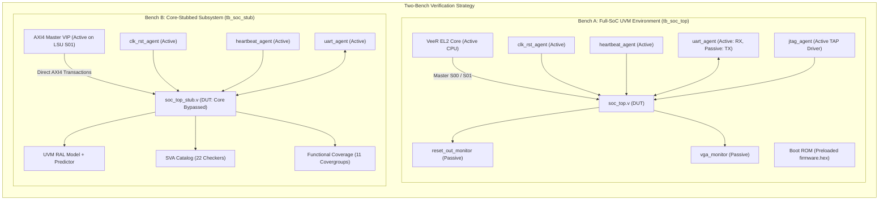
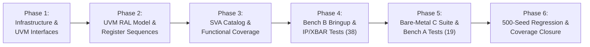
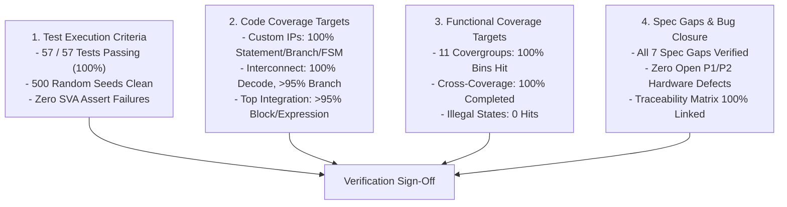

# Honour SoC — UVM Verification Realization & Implementation Plan

> **Specification References**:
> - Source Master Test Plan: [`docs/arch/14_testplan.md`](file:///e:/Projects/honours_project/docs/arch/14_testplan.md) (HRSOC-TP-001, Rev 1.0)
> - Traceability & Test Tracking Sheet: [`docs/honour_soc_verification_plan.xlsx`](file:///e:/Projects/honours_project/docs/honour_soc_verification_plan.xlsx)
> - SoC Architecture & Register Spec: [`docs/BMC_Architecture_MicroArchitecture_Spec.md`](file:///e:/Projects/honours_project/docs/BMC_Architecture_MicroArchitecture_Spec.md) & [`docs/Register_Map.md`](file:///e:/Projects/honours_project/docs/Register_Map.md)

---

## 1. Executive Summary & Verification Scope

The goal of this realization plan is to translate the **57 test cases** defined in `14_testplan.md` and tracked in `honour_soc_verification_plan.xlsx` into an industrial-grade, fully automated **Universal Verification Methodology (UVM 1.2)** verification environment.

### Verification Targets Summary (from `honour_soc_verification_plan.xlsx`):
| Sheet / Subsystem | Area Scope | Total Tests | C Firmware Tests | SystemVerilog / UVM Tests | Spec Gaps Covered | Primary Environment |
|---|---|:---:|:---:|:---:|:---:|---|
| **SoC** | Boot fetch, Reset values, Synchronous reset release, JTAG CDC, DCCM byte enables & ECC, Boot ROM burst | **9** | 5 | 9 | 2 | Bench A & B |
| **XBAR** | Address decode, DECERR, S02 debug blocking, Round-robin arbitration, Burst atomicity, Handshake backpressure, Gaskets | **12** | 1 | 12 | 3 | Bench B (Core-Stubbed) |
| **HBM** | Heartbeat edge detection, Timeout, Clear flag, Disable mode, Edge/timeout collision hazard | **5** | 0 | 5 | 1 | Bench B |
| **RSTSEQ** | Reset pulse duration, Power-up state, Retrigger busy-lock, Full FSM traversal, GPIO status reflection | **6** | 1 | 6 | 1 | Bench B & A |
| **POL** | Event log circular buffer, Lockout threshold, Rolling window tracking, Boundary conditions, Clear lockout | **10** | 0 | 10 | 3 | Bench B |
| **PERIPH** | 16550 UART TX/RX, VGA display controller, Font rendering, VBLANK timing, Monotonic timer, GPIO | **8** | 4 | 8 | 1 | Bench B & A |
| **IRQ** | PIC edge-triggered gateway (`lockout_irq`), Multi-IRQ arbitration, UART IRQ, VBLANK IRQ | **4** | 3 | 4 | 0 | Bench A (Full SoC) |
| **System** | Cold boot to firmware loop, Watchdog remediation, Crash loop lockout & resume, Steady-state, Stress concurrent | **5** | 5 | 5 | 0 | Bench A (Full SoC) |
| **Total** | **Comprehensive SoC Coverage** | **57** | **19** | **57** | **11** | **Dual-Bench Strategy** |

---

## 2. Testbench Architecture & Topology

To decouple software firmware compilation dependencies from fast, random-stimulus hardware protocol verification, the verification framework realizes the **Two-Bench Strategy** mandated by Section 3.1:



### Component Configuration & Modularity:
1. **Bench A (`tb_soc_top.sv`)**:
   - Used for **19 firmware-in-the-loop tests** and end-to-end integration (SYS-01 to SYS-05, SOC-001, IRQ-01 to IRQ-04).
   - VeeR EL2 core is active and executes bare-metal C firmware loaded into `u_rom` at `0x8000_0000`.
   - `uart_agent` acts as management terminal, validating `"HONOUR_SOC_READY\n"` synchronization banner and decoding test outcome strings.
2. **Bench B (`tb_soc_stub.sv`)**:
   - Used for **38 block, interconnect, register, protocol, and spec-gap tests**.
   - VeeR EL2 core is replaced by an **AXI4 Master VIP** attached directly to Master Port S01 (`lsu_axi_*`), with S00 (`ifu_axi_*`) tied to passive monitoring.
   - Provides cycle-accurate, zero-latency transaction injection, boundary hazard fuzzing, backpressure stress, and rapid 500-seed random regressions without firmware compilation overhead.

---

## 3. Directory Layout & Package Structure

The project structure will be organized cleanly under `tb/` and `firmware/` without polluting RTL paths:

```
honour_soc/
├── tb/
│   ├── include/
│   │   ├── soc_tb_defines.svh        # Simulation parameters, base addresses, timeouts
│   │   └── soc_tb_pkg.sv             # Master UVM package aggregating all TB components
│   ├── if/                           # SystemVerilog Interface Definitions
│   │   ├── clk_rst_if.sv             # Clock & reset generation interface
│   │   ├── axi4_if.sv                # 64-bit / 32-bit AXI4 interface with modports
│   │   ├── heartbeat_if.sv           # Heartbeat pulse interface
│   │   ├── uart_if.sv                # UART RX/TX serial interface
│   │   ├── vga_if.sv                 # VGA pixel clock, sync & RGB interface
│   │   ├── pic_irq_if.sv             # PIC extintsrc_req[3:0] interrupt bus
│   │   ├── reset_out_if.sv           # Host reset output monitoring interface
│   │   └── jtag_if.sv                # IEEE 1149.1 JTAG interface
│   ├── agents/                       # UVM Verification Components (UVCs)
│   │   ├── clk_rst_agent/            # Active clock/reset sequencer & driver
│   │   ├── heartbeat_agent/          # Programmable pulse & jitter generator
│   │   ├── uart_agent/               # 16550 serial transceiver & frame checker
│   │   ├── axi_master_agent/         # AXI4 VIP (driver, monitor, sequencer)
│   │   ├── reset_out_monitor/        # Host power reset duration & polarity checker
│   │   ├── vga_monitor/              # RGB444 frame reconstruction & VBLANK monitor
│   │   └── pic_irq_monitor/          # Interrupt timing & latency tracker
│   ├── ral/                          # UVM Register Abstraction Layer (RAL)
│   │   ├── reg_uart.sv               # UART 16550 registers
│   │   ├── reg_timer.sv              # 32-bit Uptime Timer register
│   │   ├── reg_gpio.sv               # GPIO Status register
│   │   ├── reg_heartbeat.sv          # Heartbeat Monitor registers
│   │   ├── reg_reset_sequencer.sv    # Reset Sequencer registers
│   │   ├── reg_recovery_policy.sv    # Recovery Policy & Event Log registers
│   │   ├── reg_vga.sv                # VGA Status & 40x3 Text Buffer
│   │   ├── reg_boot_rom.sv           # 8KB Boot ROM memory model
│   │   ├── soc_reg_block.sv          # Top-level RAL block aggregating all slaves
│   │   └── axi2reg_adapter.sv        # AXI4-to-UVM_REG transaction adapter
│   ├── env/                          # Environment, Scoreboards & Coverage
│   │   ├── soc_env_config.sv         # Active/passive switch & bench mode configuration
│   │   ├── soc_env.sv                # Instantiates agents, RAL, scoreboard, coverage
│   │   ├── soc_scoreboard.sv         # End-to-end transaction matching & checking
│   │   └── soc_coverage.sv           # 11 functional covergroups (Section 5)
│   ├── sva/                          # SystemVerilog Assertions Catalog
│   │   ├── sva_axi_protocol.sv       # SVA-AXI-01..04
│   │   ├── sva_heartbeat_monitor.sv  # SVA-HBM-01..04
│   │   ├── sva_reset_sequencer.sv    # SVA-RST-01..04
│   │   ├── sva_recovery_policy.sv    # SVA-POL-01..04
│   │   ├── sva_irq_timing.sv         # SVA-IRQ-01..02
│   │   └── sva_soc_bind.sv           # Top-level bind directives
│   ├── seq/                          # UVM Virtual Sequences & Test Stimuli
│   │   ├── soc_vseq_base.sv          # Base virtual sequence
│   │   ├── soc_reg_reset_vseq.sv     # Register reset test sequence
│   │   ├── soc_xbar_decode_vseq.sv   # Crossbar routing & DECERR sequence
│   │   ├── soc_hbm_stress_vseq.sv    # Heartbeat timeout & collision sequence
│   │   ├── soc_rst_pulse_vseq.sv     # Reset sequencer timing & retrigger sequence
│   │   └── soc_pol_log_vseq.sv       # Recovery policy window & lockout sequence
│   ├── tests/                        # UVM Test Cases
│   │   ├── soc_test_base.sv          # Base test class with environment construction
│   │   ├── bench_b/                  # Tests targeted for Bench B (38 tests)
│   │   └── bench_a/                  # Tests targeted for Bench A (19 tests)
│   ├── tb_soc_top.sv                 # Top-level testbench for Bench A
│   └── tb_soc_stub.sv                # Top-level testbench for Bench B
└── firmware/
    ├── include/                      # Drivers & peripheral register definitions
    │   ├── honour_soc.h              # MMIO addresses, bitfields, register macros
    │   └── uart.h                    # Polled UART print primitives
    ├── lib/                          # Startup & runtime support
    │   ├── crt0.S                    # MRAC setup, stack pointer, BSS clearing
    │   ├── link.ld                   # Linker script: ROM @ 0x8000_0000, DCCM @ 0xF004_0000
    │   └── pic.c                     # VeeR PIC gateway & ISR installation routines
    └── tests/                        # Dedicated C test firmware files
        ├── test_boot_sanity.c        # SOC-001, SYS-01 (Banner & peripheral probe)
        ├── test_dccm_access.c        # SOC-007 (Byte, halfword, word R/W & ECC)
        ├── test_csr_access.c         # VeeR core CSR verification
        ├── test_watchdog_remediation.c # SYS-02 (Timeout detection & reset cycle)
        ├── test_crashloop_lockout.c  # SYS-03 (Lockout trigger, IRQ & clear)
        ├── test_steady_state.c       # SYS-04 (Continuous healthy heartbeat)
        ├── test_stress_concurrent.c  # SYS-05 (Heavy multi-peripheral traffic)
        ├── test_irq_arbitration.c    # IRQ-01..04 (PIC priority & gateway setup)
        └── test_vga_console.c        # PER-05..08 (Text buffer programming & VBLANK)
```

---

## 4. Phased Implementation Roadmap

The testplan will be realized across **6 systematic execution phases**:



### Phase 1: VIP Infrastructure & Pin Interfaces
- **Step 1.1**: Define SystemVerilog interfaces with clocking blocks and modports for all SoC boundaries (`clk_rst_if`, `heartbeat_if`, `uart_if`, `vga_if`, `pic_irq_if`, `reset_out_if`, `jtag_if`, `axi4_if`).
- **Step 1.2**: Implement UVM agents for non-AXI interfaces:
  - `clk_rst_agent`: Synchronous reset release and clock generation.
  - `heartbeat_agent`: Programmable watchdog strobe generator with cycle-accurate jitter and timeout control.
  - `uart_agent`: 16550 serial transceiver with automatic baud-rate detection (115200 baud, 16x oversampling) and banner checker.
  - `reset_out_monitor`: Samples `reset_out` duration, enforces active-low assertion, and verifies default high state.
  - `pic_irq_monitor`: Timestamped logging of `extintsrc_req[3:0]`.
  - `vga_monitor`: Decodes RGB444 pixels, computes line/frame rates (640x480 @ 60Hz), and checks VBLANK pulses.
- **Step 1.3**: Configure AXI4 Master VIP & Monitors:
  - Instantiate 64-bit AXI4 Master VIP driver and sequencer for Bench B.
  - Implement passive AXI4 monitors for S00 (IFU), S01 (LSU), S02 (SB), and taps on peripheral slaves M00–M07.

### Phase 2: Register Abstraction Layer (RAL) & Register Sequences
- **Step 2.1**: Implement `uvm_reg` classes for all 8 memory-mapped slave blocks:
  - `reg_uart`: UART 16550 register map (`0x0002_0000`).
  - `reg_timer`: Uptime Timer register map (`0x0002_0100`).
  - `reg_gpio`: GPIO Status register map (`0x0002_0200`).
  - `reg_heartbeat`: Heartbeat Monitor registers (`0x0002_0300`).
  - `reg_reset_sequencer`: Power/Reset Sequencer registers (`0x0002_0400`).
  - `reg_recovery_policy`: Recovery Policy & Circular Event Log (`0x0002_0500`).
  - `reg_vga`: VGA Status & Character Frame Buffer (`0x0002_0600`).
  - `reg_boot_rom`: Read-only Boot ROM model (`0x8000_0000`).
- **Step 2.2**: Implement `axi2reg_adapter` to convert `uvm_reg_bus_op` to AXI4 transactions.
- **Step 2.3**: Configure RAL exclusion list (Section 19 of test plan):
  - Exclude `RST_CTRL.trigger` from standard write/read sequences (self-clearing side effect).
  - Exclude volatile live registers (`TMR_CTR`, `HB_ELAPSED`, `GPIO_STAT`, `UART_LSR`) from static read-back checks.
- **Step 2.4**: Realize standard UVM RAL sequences:
  - `uvm_reg_hw_reset_seq`: Validates bit-for-bit reset values across all 8 slaves (covers `SOC-002`, `TP-REG-01`).
  - `uvm_reg_bit_bash_seq`: Validates read/write accessibility and bit-mask isolation.
  - `soc_reg_ro_seq`: Writes `0xFFFFFFFF` to all read-only registers and confirms zero modification (covers `SOC-003`, `TP-REG-03`).

### Phase 3: Assertion Catalog (SVA) & Functional Coverage Model
- **Step 3.1**: Implement the complete catalog of **22 SystemVerilog Assertions (SVAs)** and bind them to RTL modules via `sva_soc_bind.sv`:
  - `SVA-CLK-01..02`: Clock stability and reset-release cleanliness.
  - `SVA-AXI-01..04`: AXI protocol handshakes, DECERR on unmapped space, burst rules, slave response validity.
  - `SVA-HBM-01..04`: Heartbeat timeout sticky latching, timeout latency, petting counter reset.
  - `SVA-RST-01..04`: Active-low pulse duration, atomic hold cycles, retrigger rejection during busy.
  - `SVA-POL-01..04`: Event log circular index wrap, lockout threshold latching, rolling window boundary clearing.
  - `SVA-IRQ-01..02`: PIC gateway edge pulse latching and interrupt deassertion.
  - `SVA-PER-01..02`: UART frame formatting and VGA VBLANK periodicity.
- **Step 3.2**: Implement the **11 Functional Covergroups** in `soc_coverage.sv`:
  - `cg_heartbeat_fsm`: All 3 states (`DISABLED`, `HEALTHY`, `UNRESPONSIVE`) and transitions.
  - `cg_heartbeat_threshold`: Minimum, nominal, and maximum timeout intervals.
  - `cg_rst_seq_fsm`: States (`IDLE`, `ASSERT_RESET`, `WAIT_RECOVERY`) and valid/invalid transitions.
  - `cg_rst_hold_cycles`: Reset duration bins (10, 50, 100, 255 cycles).
  - `cg_rec_policy_lockout`: Events reaching threshold (1..3) and lockout flag trigger.
  - `cg_rec_policy_log`: Circular write index wrapping (0..15 -> 0) and log reading.
  - `cg_axi_decode`: All 8 slave targets (M00..M07) and unmapped addresses.
  - `cg_axi_resp`: `OKAY`, `DECERR`, and `SLVERR` response coverage.
  - `cg_irq_lines`: Individual and simultaneous firing of `extintsrc_req[3:0]`.
  - `cg_uart_path`: Baud divisor configurations, TX/RX FIFO occupancy, error bits.
  - `cg_vga_buffer`: Cursor positioning, character font mapping, and active screen bounds.

### Phase 4: Bench B Implementation & IP / Interconnect Verification (38 Tests)
- **Step 4.1**: Build `tb_soc_stub.sv`:
  - Instantiate `soc_top` with the VeeR core stubbed or bypassed.
  - Connect AXI VIP master to LSU S01 port.
- **Step 4.2**: Execute Interconnect Tests (`XBR-001` to `XBR-012`):
  - Legal slave routing, unmapped address DECERR generation, S02 debug port decode blocking.
  - Concurrent master arbitration (S00 vs S01 round-robin fairness), backpressure stress, 64-to-32 bit gasket width steering.
- **Step 4.3**: Execute Heartbeat Monitor Tests (`HBM-01` to `HBM-05`):
  - Normal petting, timeout detection, sticky flag latching, disable mode, and edge/timeout collision race (`TP-GAP-01`).
- **Step 4.4**: Execute Reset Sequencer Tests (`RST-01` to `RST-06`):
  - Pulse duration measurement, atomic lock (retrigger rejection), FSM traversal, and retrigger at ASSERT->DEASSERT boundary (`TP-GAP-04`).
- **Step 4.5**: Execute Recovery Policy Tests (`POL-01` to `POL-10`):
  - Rolling window event logging, lockout latching, circular buffer wrap, boundary rollover (`TP-GAP-05`), and lockout persistence (`TP-GAP-07`).
- **Step 4.6**: Execute Peripheral Subsystem Tests (`PER-01` to `PER-08`):
  - UART loopback and framing, VGA text buffer write/readback, VBLANK timing, and multi-master gasket access (`TP-GAP-06`).

### Phase 5: Bare-Metal C Firmware Suite & Bench A Full SoC Bringup (19 Tests)
- **Step 5.1**: Develop bare-metal RISC-V C test programs under `firmware/tests/`:
  - `test_boot_sanity.c`: Boots core, clears BSS, checks peripheral presence, prints `"HONOUR_SOC_READY\n"` (`SOC-001`, `SYS-01`).
  - `test_dccm_access.c`: Tests 64KB DCCM byte, halfword, word access and ECC integrity (`SOC-007`, `SOC-008`).
  - `test_irq_arbitration.c`: Programs PIC gateway (`meigwctrl[3] = 0x1` for edge-triggered `lockout_irq`), tests ISR priority and multi-IRQ servicing (`IRQ-01` to `IRQ-04`).
  - `test_watchdog_remediation.c`: Enables heartbeat monitor, detects timeout via `hb_irq`, logs event in recovery policy, triggers reset sequencer (`SYS-02`).
  - `test_crashloop_lockout.c`: Cycles watchdog timeouts until 3 events hit `POL_WINDOW`, verifies hardware lockout flag and ISR suppression, receives unlock command over UART, clears lockout (`SYS-03`, `TP-ERR-03`).
  - `test_steady_state.c`: Continuous periodic petting in main loop under long run (`SYS-04`).
  - `test_stress_concurrent.c`: Concurrent memory access, UART logging, VGA buffer updates, and timer reads under intense traffic (`SYS-05`).
- **Step 5.2**: Build Bench A testbench `tb_soc_top.sv` instantiating full `soc_top` with active VeeR EL2 core.
- **Step 5.3**: Run and verify all 19 Full-SoC tests with `uart_agent` scoreboard matching.

### Phase 6: Regression Automation, Coverage Closure & Sign-off
- **Step 6.1**: Update `Makefile` with UVM regression workflows:
  - `make uvm_bench_b TEST=<name> [SEED=<n>] [VCD=1|FSDB=1]`
  - `make uvm_bench_a TEST=<name> [FW=<c_file>] [VCD=1|FSDB=1]`
  - `make uvm_regression SEEDS=500` (dispatches 500 randomized seeds across Bench B).
  - `make uvm_cov_report` (merges URDB coverage databases and generates HTML/Verdi reports).
- **Step 6.2**: Coverage closure execution:
  - Verify **100% statement, branch, toggle, and FSM condition coverage** across all custom IP blocks.
  - Verify **100% functional coverage** on all 11 covergroups in `soc_coverage.sv`.
  - Ensure **zero SVA checker failures** across all regression seeds.
- **Step 6.3**: Update `docs/honour_soc_verification_plan.xlsx` with test status and pass/fail metrics.

---

## 5. Master Test-to-Environment Traceability Matrix

| ID | Test Name | Source TP | Bench | Stimulus Driver | Checkpoint & Success Criteria |
|---|---|---|:---:|---|---|
| **SOC-001** | Boot ROM First Fetch | `TP-RST-01` | **Bench A** | VeeR Core / `test_boot_sanity.c` | First AR to `0x8000_0000` $\le 5$ cycles after `rst_n` deasserts; UART outputs `"HONOUR_SOC_READY"`. |
| **SOC-002** | Register Reset Values | `TP-REG-01` | **Bench B** | RAL `uvm_reg_hw_reset_seq` | All registers match documented reset values bit-for-bit; FSMs in default states. |
| **SOC-003** | Read-Only Register Protection | `TP-REG-03` | **Bench B** | RAL `soc_reg_ro_seq` | Writes to read-only registers are absorbed with zero modification; status values unchanged. |
| **SOC-004** | Synchronous Reset Release | `TP-CLK-02` | **Bench B** | `clk_rst_agent` / AXI VIP | Registers achieve legal defaults on the very first clock cycle after `rst_n` release. |
| **SOC-005** | AXI Access During Reset | `TP-GAP-02` | **Bench B** | AXI VIP | Reset asserted while ARVALID/AWVALID pending; bus resets cleanly without protocol deadlock. |
| **SOC-006** | JTAG CDC Crossing | `TP-CLK-03` | **Bench A** | `jtag_agent` | TAP controller accesses debug registers without metastability or sync errors. |
| **SOC-007** | DCCM Byte Enables | `TP-DAT-01` | **Bench A** | VeeR / `test_dccm_access.c` | Byte, halfword, and unaligned accesses preserve non-targeted bytes in DCCM. |
| **SOC-008** | DCCM ECC Error Handling | `TP-MEM-01` | **Bench A** | Core / Backdoor Injection | 1-bit correctable and 2-bit uncorrectable ECC error injection handled per spec. |
| **SOC-009** | Boot ROM 64-bit Burst | `TP-DAT-05` | **Bench A** | VeeR IFU / Boot ROM | Core fetches 64-bit instruction bursts continuously without wait-state corruptions. |
| **XBR-001** | Decode Routing All Slaves | `TP-DEC-01` | **Bench B** | AXI VIP | Writes and reads to M00–M07 route correctly and return `OKAY`. |
| **XBR-002** | Unmapped Address DECERR | `TP-DEC-02` | **Bench B** | AXI VIP | Accesses to unmapped memory holes return `DECERR` with zero side-effects (`SVA-AXI-01`). |
| **XBR-003** | In-Window Undecoded Offsets | `TP-DEC-05` | **Bench B** | AXI VIP | Offsets inside 256B peripheral blocks return `OKAY` and do not trigger decode error. |
| **XBR-004** | S02 Blocked from M00..M06 | `TP-DEC-03` | **Bench A** | VeeR Debug Unit | Debug bus S02 cannot access peripheral slaves M00–M06. |
| **XBR-005** | S02 Access to Boot ROM M07 | `TP-DEC-04` | **Bench A** | VeeR Debug Unit | Debug bus S02 successfully reads Boot ROM (M07). |
| **XBR-006** | Round-Robin Fairness S00/S01 | `TP-ARB-01` | **Bench B** | AXI VIP | Simultaneous requests from S00 and S01 alternate fairly without master starvation. |
| **XBR-007** | Interleaved Write Addr & Data | `TP-ARB-02` | **Bench B** | AXI VIP | AWVALID and WVALID asserted with arbitrary skew and interleaving without stalls. |
| **XBR-008** | Concurrent Read & Write | `TP-ARB-03` | **Bench B** | AXI VIP | Independent read and write channels operate simultaneously at maximum line rate. |
| **XBR-009** | Burst Atomicity | `TP-ARB-04` | **Bench B** | AXI VIP | Multi-beat bursts execute uninterrupted without other master interleave. |
| **XBR-010** | AXI Backpressure Handling | `TP-DAT-06` | **Bench B** | AXI VIP | Slave `READY` deassertion and wait states handled cleanly without data drop. |
| **XBR-011** | UART 64-to-32 Gasket Steering | `TP-DAT-02` | **Bench B** | AXI VIP | 64-bit AXI crossbar data correctly steered to 32-bit UART register lane based on address. |
| **XBR-012** | Interleaved Multi-Master Gasket | `TP-GAP-06` | **Bench B** | AXI VIP | Concurrent accesses to 32-bit gasket from multiple masters maintain ordering integrity. |
| **HBM-01** | Heartbeat Edge & Counter Reset | `TP-CTRL-01` | **Bench B** | `heartbeat_agent` | Rising edges on `heartbeat_in` reset `HB_ELAPSED` counter back to 0. |
| **HBM-02** | Heartbeat Watchdog Timeout | `TP-CTRL-02` | **Bench B** | `heartbeat_agent` | Silence exceeding `HB_THRESHOLD` asserts `unresponsive_flag` and `hb_irq` (`SVA-HBM-01`). |
| **HBM-03** | HB_CTRL Clear Flag | `TP-REG-02` | **Bench B** | AXI VIP | Writing `HB_CTRL.clear_flag` clears `unresponsive_flag` and deasserts `hb_irq`. |
| **HBM-04** | Heartbeat Monitor Disable | `TP-CTRL-07` | **Bench B** | AXI VIP | Setting `HB_CTRL.enable = 0` stops counter; timeouts suppressed. |
| **HBM-05** | Heartbeat Edge/Timeout Collision | `TP-GAP-01` | **Bench B** | `heartbeat_agent` / VIP | Edge arriving on exact timeout cycle: edge takes priority, timeout prevented. |
| **RST-01** | Reset Sequencer Power-Up State | `TP-RST-02` | **Bench B** | `reset_out_monitor` | Power-on: `reset_out = 1`, `RST_STATUS = 0x0` (IDLE), `RST_HOLD_CYCLES = 100`. |
| **RST-02** | Reset Trigger & Pulse Duration | `TP-RST-03` | **Bench B** | AXI VIP / `reset_out_monitor` | Setting `RST_CTRL.trigger` pulls `reset_out` low for exact `RST_HOLD_CYCLES` clocks (`SVA-RST-01`). |
| **RST-03** | GPIO_STAT Reflects reset_out | `TP-RST-04` | **Bench B** | AXI VIP | `GPIO_STAT[1]` dynamically tracks physical `reset_out` pad level during assertion. |
| **RST-04** | Retrigger Rejection (Busy-Lock) | `TP-CTRL-03` | **Bench B** | AXI VIP | Secondary triggers issued while reset sequence in progress are rejected (`SVA-RST-03`). |
| **RST-05** | Reset Sequencer Full FSM | `TP-CTRL-08` | **Bench B** | AXI VIP | Verifies all state transitions: `IDLE` -> `ASSERT` -> `WAIT_RECOVERY` -> `IDLE`. |
| **RST-06** | Retrigger at Boundary | `TP-GAP-04` | **Bench B** | AXI VIP | Retrigger requested on exact cycle `ASSERT` transitions to `WAIT_RECOVERY`: rejected. |
| **POL-01** | Circular Event Log Write & Read | `TP-REG-04` | **Bench B** | AXI VIP | Staged event written to circular RAM; readable via `LOG_READ_IDX`. |
| **POL-02** | Recovery Policy Lockout Trigger | `TP-CTRL-04` | **Bench B** | AXI VIP | `POL_THRESHOLD` (3) events inside `POL_WINDOW` sets `lockout_flag` and fires `lockout_irq`. |
| **POL-03** | POL_CTRL Clear Lockout | `TP-REG-06` | **Bench B** | AXI VIP | Writing `POL_CTRL.clear_lockout` clears `lockout_flag` and restores recovery readiness. |
| **POL-04** | Rolling Window Reset Clears Count | `TP-CTRL-05` | **Bench B** | AXI VIP | Elapsed window cycle expiration clears rolling event count. |
| **POL-05** | Events Spanning Window Boundary | `TP-CTRL-06` | **Bench B** | AXI VIP | Events spaced across window boundaries do not trip threshold lockout. |
| **POL-06** | Event Log Circular Wrap-Around | `TP-ERR-02` | **Bench B** | AXI VIP | >16 events wrap circular RAM cleanly; `LOG_COUNT` increments monotonically (saturates at 32'hFFFF_FFFF), latest entries overwrite oldest in 16-slot RAM. |
| **POL-07** | Event on Window Rollover Cycle | `TP-GAP-05` | **Bench B** | AXI VIP | Event occurring on exact window expiration cycle correctly counted in new window. |
| **POL-08** | Lockout Persistence Across Window | `TP-GAP-07` | **Bench B** | AXI VIP | Once tripped, `lockout_flag` remains asserted across window rollovers until explicitly cleared. |
| **POL-09** | Firmware Lockout Suppression | `TP-ERR-03` | **Bench A** | VeeR / `test_crashloop_lockout.c` | Software supervisor enforces lockout: suppresses reset trigger when `lockout_flag = 1`. |
| **POL-10** | Log Wrap Detection by Firmware | `TP-GAP-03` | **Bench A** | VeeR / Firmware | Firmware monitors `LOG_COUNT > 16` and handles log overrun telemetry. |
| **PER-01** | UART TX and RX Path Loopback | `TP-DAT-03` | **Bench B** | `uart_agent` | Characters written to `UART_THR` serialized correctly; RX FIFO receives input without errors. |
| **PER-02** | UART IRQ Assertion/Deassertion | `TP-IRQ-03` | **Bench B** | `uart_agent` / VIP | RX data available and TX FIFO empty assert `uart_irq`; cleared by reading `RBR`/`IIR`. |
| **PER-03** | System Timer Monotonic Increment | Spec | **Bench B** | AXI VIP | `TMR_CTR` increments by 1 on every clock; read-only protection enforced. |
| **PER-04** | GPIO Pin Status Reflection | Spec | **Bench B** | AXI VIP | Reflects external inputs and internal `reset_out` status. |
| **PER-05** | VGA Character Frame Rendering | `TP-DAT-04` | **Bench B** | `vga_monitor` | Character ASCII values written to text buffer accurately reconstructed into glyph frames. |
| **PER-06** | VGA Buffer Read/Write | `TP-REG-05` | **Bench B** | AXI VIP | Full 40x3 text buffer word-addressed R/W verified bit-for-bit. |
| **PER-07** | VGA VBLANK Timing & IRQ | `TP-IRQ-04` | **Bench B** | `vga_monitor` | 60Hz vertical blanking interval produces calibrated `vblank_irq` pulse. |
| **PER-08** | VGA pixel_clk_en Cadence | `TP-CLK-01` | **Bench B** | `vga_monitor` | Pixel clock enable asserts once every 4 system clock cycles (25 MHz pixel clock). |
| **IRQ-01** | PIC Gateway Edge-Trigger Setup | `TP-IRQ-01` | **Bench A** | VeeR / `test_irq_arbitration.c` | Configures `meigwctrl[3] = 0x1`; ensures 1-cycle `lockout_irq` pulse is reliably captured. |
| **IRQ-02** | PIC Priority & Multi-IRQ | `TP-IRQ-02` | **Bench A** | VeeR / `test_irq_arbitration.c` | Simultaneous assertion of UART, HB, and Lockout IRQs serviced strictly in priority order. |
| **SYS-01** | Cold Boot to Firmware Loop | `TP-E2E-01` | **Bench A** | VeeR / `test_boot_sanity.c` | Power-on boot -> CRT0 -> `main()` -> UART banner -> steady-state loop. |
| **SYS-02** | Watchdog Remediation Cycle | `TP-E2E-02` | **Bench A** | VeeR / `test_watchdog_remediation.c` | Host timeout -> `hb_irq` -> event logged -> reset pulse triggered -> host restored. |
| **SYS-03** | Crash-Loop Lockout & Resumption | `TP-E2E-03` | **Bench A** | VeeR / `test_crashloop_lockout.c` | 3 successive timeouts trigger lockout; resets blocked until unlock character received on UART. |
| **SYS-04** | Healthy Steady-State Execution | `TP-E2E-04` | **Bench A** | VeeR / `test_steady_state.c` | Continuous periodic heartbeat; zero spurious faults, resets, or lockouts. |
| **SYS-05** | Simultaneous Stress Under Bus Traffic | `TP-E2E-05` | **Bench A** | VeeR / `test_stress_concurrent.c` | High bus saturation: concurrent UART streaming, timer reads, VGA buffer updates, and heartbeat. |

---

## 6. Verification Sign-off Criteria & Coverage Targets

Per Section 20 of `14_testplan.md`, the verification campaign achieves formal sign-off when all of the following quantified milestones are satisfied:



1. **Test Execution**:
   - 100% pass rate across all 57 test cases in both Bench A and Bench B.
   - Zero testbench error reports or scoreboard mismatches.
   - Complete 500-seed randomized regression on Bench B with zero protocol violations.
2. **Code Coverage**:
   - `soc_top.v` & custom IPs (`heartbeat_monitor`, `reset_sequencer`, `recovery_policy`, `vga_controller`): **100% statement, 100% branch, 100% FSM condition**.
   - `axi_interconnect_wrap_3x8.v`: **100% decode path coverage, >95% branch coverage**.
3. **Functional Coverage**:
   - 100% coverage on all 11 UVM covergroups in `soc_coverage.sv`.
   - Zero unhit bins without a formally approved engineering waiver.
4. **SVA & Protocol Verification**:
   - All 22 SVAs active and evaluated continuously throughout all regression runs with zero failure reports.
5. **Spec Gap Closure**:
   - Successful verification of all 7 critical edge/hazard corner cases (`TP-GAP-01` through `TP-GAP-07`).

