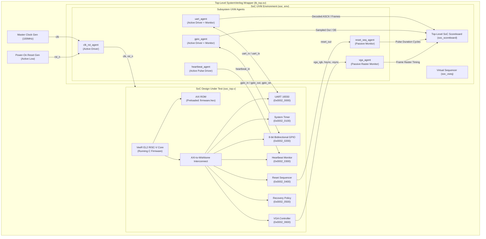
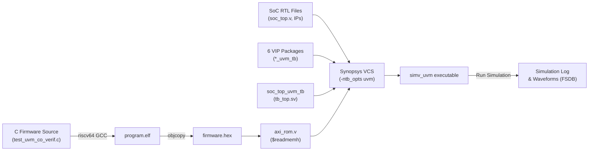

# Honour SoC — Comprehensive UVM & C Firmware Co-Verification Execution Plan

**Document ID**: `ARCH-VERIF-18`  
**Revision**: `v1.0`  
**Status**: `Approved / Implementation Ready`  
**Target Architecture**: Honour SoC (VeeR EL2 RV32IMC Core + 8 Subsystems + 6 External VIPs)  
**Verification Methodology**: IEEE 1800.2 UVM Co-Simulation Driven by Bare-Metal RISC-V Firmware  

---

## 1. Executive Summary & Verification Objectives

### 1.1 Purpose
The purpose of this document is to define the exact, non-abstract, register-by-register and cycle-by-cycle execution plan for co-verifying the **Honour SoC** hardware utilizing bare-metal C firmware running on the embedded RISC-V VeeR EL2 core in direct synchronization with an industry-standard **SystemVerilog/UVM 1.2 Testbench Environment**.

### 1.2 The Co-Verification Paradigm
Unlike standalone unit testbenches where an AXI master VIP drives bus transactions directly, the Honour SoC full-chip environment relies on **100% C Firmware + 100% SystemVerilog UVM Co-Verification**:
1. **Internal Bus Traffic**: Driven autonomously by the VeeR EL2 CPU executing bare-metal C compiled binaries loaded into instruction memory (`axi_rom.v`).
2. **External Boundary Stimulus**: Driven by dedicated active UVM VIP drivers into the SoC physical package pins.
3. **External Boundary Checking**: Sampled cycle-by-cycle by passive UVM VIP monitors connected to the SoC output package pins.
4. **End-to-End Scoreboarding**: Reconciles CPU firmware status output (via UART telemetry) with physical package pin transitions observed by the UVM VIPs.

```
       +---------------------------------------------------------------------------------+
       |                              HONOUR SOC CHIP BOUNDARY                           |
       |                                                                                 |
       |  +--------------------+     AXI4-Lite      +-------------------+   Boundary     |
       |  | VeeR EL2 CPU Core  |===================>|  Wishbone Decoder |    Pins        |
       |  | (Executes Firmware)|                    +---------+---------+      |         |
       |  +--------------------+                              |                |         |
       |                               +----------------------+------------+   |         |
       |                               |                      |            |   |         |
       |                               v                      v            v   v         |
       |                        +-------------+        +------------+   +------+------+  |
       |                        | UART 16550  |        | 8-bit GPIO |   | Custom BMC  |  |
       |                        +------+------+        +------+-----+   +------+------+  |
       +-------------------------------|----------------------|----------------|---------+
                                       |                      |                |
                          +------------+------------+         |                |
                          | uart_rx / uart_tx       | gpio_in/out/oe           | heartbeat_in / reset_out
                          v                         v                          v
       +---------------------------------------------------------------------------------+
       |                        UVM TESTBENCH ENVIRONMENT (tb_top)                       |
       |                                                                                 |
       |   +---------------+     +---------------+     +---------------+                 |
       |   |   uart_vip    |     |   gpio_vip    |     |   bmc_vips    |   scoreboards   |
       |   | (Agent/Score) |     | (Agent/Score) |     |  (HB + Reset) |   & checkers    |
       |   +---------------+     +---------------+     +---------------+                 |
       +---------------------------------------------------------------------------------+
```

---

## 2. Co-Verification Topology & Architecture

The testbench comprises **6 independent UVM VIP agents** coordinated by a central top-level environment ([`soc_top_uvm_tb/soc_env.sv`](file:///home/student/sriv_183/honour_soc/soc_top_uvm_tb/soc_env.sv)) and instantiated in the top testbench module ([`soc_top_uvm_tb/tb_top.sv`](file:///home/student/sriv_183/honour_soc/soc_top_uvm_tb/tb_top.sv)):



---

## 3. Peripheral CSR Bitfield & Stimulus Specification

The firmware test communicates with 6 hardware targets via memory-mapped I/O (MMIO). All registers are 32-bit word-aligned:

| Peripheral | Base Address | Register | Offset | Access | Key Bitfields & Functional Semantics |
| :--- | :--- | :--- | :--- | :--- | :--- |
| **UART 16550** | `0x0002_0000` | `UART_RBR` | `0x00` | RO | `[7:0]` Received character byte from `uart_rx` |
| | | `UART_THR` | `0x00` | WO | `[7:0]` Transmit character byte onto `uart_tx` |
| | | `UART_IER` | `0x04` | R/W | `[0]` ERBFI (Rx Data Ready IRQ), `[1]` ETBEI (Tx Holding Empty IRQ) |
| | | `UART_FCR` | `0x08` | WO | `[0]` FIFO Enable, `[1]` Rx FIFO Clear, `[2]` Tx FIFO Clear |
| | | `UART_LCR` | `0x0C` | R/W | `[1:0]` Word Length (11=8-bit), `[7]` DLAB (Divisor Latch Access Bit) |
| | | `UART_LSR` | `0x14` | RO | `[0]` DR (Data Ready), `[5]` THRE (Tx Holding Empty), `[6]` TEMT |
| **GPIO** | `0x0002_0200` | `GPIO_DATA` | `0x00` | R/W | `[7:0]` Pin Data: writes update `gpio_out` (when enabled); reads sample `(gpio_in & ~gpio_dir) | (gpio_out & gpio_dir)` |
| | | `GPIO_DIR` | `0x04` | R/W | `[7:0]` Direction: `1'b1` = Output (`gpio_oe=1`), `1'b0` = Input (`gpio_oe=0`) |
| | | `GPIO_STAT` | `0x08` | RO | `[0]` Sampled `reset_out`, `[1]` Sampled `heartbeat_in` |
| **Heartbeat Monitor** | `0x0002_0300` | `HB_CTRL` | `0x00` | WO | `[0]` Enable monitor (`1` = active timeout countdown) |
| | | `HB_TIMEOUT` | `0x08` | R/W | `[31:0]` Timeout cycle limit before triggering recovery/alarm |
| | | `HB_STATUS` | `0x0C` | RO | `[0]` Active status, `[1]` Timeout event fired (sticky until reset) |
| **Reset Sequencer** | `0x0002_0400` | `RST_CTRL` | `0x00` | WO | `[0]` Trigger hardware reset pulse on `reset_out` (self-clearing) |
| | | `RST_HOLD_CYCLES`| `0x04` | R/W | `[31:0]` Duration to hold `reset_out` LOW (Clock cycles, default 100) |
| | | `RST_STATUS` | `0x08` | RO | `[0]` `in_progress` (1 = pulsing), `[1]` `complete` (1 = finished) |
| **Recovery Policy** | `0x0002_0500` | `POL_CTRL` | `0x00` | WO | `[0]` Record event, `[1]` Clear lockout |
| | | `POL_STATUS` | `0x0C` | RO | `[0]` Lockout active, `[15:8]` Window recovery count |
| **VGA Dashboard** | `0x0002_0600` | `VGA_CTRL` | `0x00` | R/W | `[0]` Display Engine Enable, `[1]` Color bar mode enable |
| | | `VGA_STATUS` | `0x04` | RO | `[0]` `v_sync_active`, `[1]` `h_sync_active` |

---

## 4. End-to-End Co-Verification Chronology & Protocol Sequence

The following sequence diagram specifies the cycle-accurate synchronization between the C Firmware executing inside the SoC core and the UVM VIP agents stimulating the boundary pins:

```mermaid
sequenceDiagram
    autonumber
    participant TB as Top Testbench (tb_top)
    participant CLK_RST as clk_rst_agent
    participant CPU as VeeR Core (C Firmware)
    participant UART_VIP as uart_agent
    participant GPIO_VIP as gpio_agent
    participant HB_VIP as heartbeat_agent
    participant RST_VIP as reset_seq_agent
    participant SB as SoC Scoreboard

    Note over TB,CLK_RST: Phase 0: Reset & Bringup
    CLK_RST->>DUT: Assert rst_n = 0 (100ns)
    CLK_RST->>DUT: Deassert rst_n = 1
    CPU->>CPU: Boot from axi_rom (firmware.hex)
    CPU->>CPU: Configure MRAC (0x0002_0000 = non-cacheable MMIO)

    Note over CPU,UART_VIP: Phase 1: UART Handshake & Bi-directional Validation
    CPU->>DUT: Write "UVM_SYNC\n" to UART_THR (0x0002_0000)
    DUT-->>UART_VIP: Serial Tx frames on uart_tx
    UART_VIP->>SB: Broadcast decoded string: "UVM_SYNC"
    SB->>SB: Match expected bringup banner

    UART_VIP->>DUT: Driver injects serial byte 0xA5 onto uart_rx
    CPU->>DUT: Poll UART_LSR[0] until Data Ready == 1
    CPU->>DUT: Read UART_RBR (assert value == 0xA5)
    CPU->>DUT: Write "UART_OK\n" to UART_THR

    Note over CPU,GPIO_VIP: Phase 2: Standard 8-bit GPIO Loopback & Direction
    CPU->>DUT: Write GPIO_DIR = 0x0F (pins [3:0] out, pins [7:4] in)
    CPU->>DUT: Write GPIO_DATA = 0x0A (drive lower nibble = 0xA)
    DUT-->>GPIO_VIP: gpio_out[3:0] = 4'hA, gpio_oe[3:0] = 4'hF
    GPIO_VIP->>SB: Verify lower nibble output and output enable

    GPIO_VIP->>DUT: Driver drives gpio_in[7:4] = 4'h5
    CPU->>DUT: Read GPIO_DATA (assert bits [7:4] == 4'h5)
    CPU->>DUT: Write "GPIO_OK\n" to UART_THR

    Note over CPU,HB_VIP: Phase 3: Watchdog Heartbeat Ingestion & Timeout
    CPU->>DUT: Configure HB_TIMEOUT = 500 cycles; Write HB_CTRL = 1 (Enable)
    loop 5 Heartbeat Pulses
        HB_VIP->>DUT: Pulse heartbeat_in = 1 for 2 cycles every 80 cycles
    end
    CPU->>DUT: Read HB_STATUS (assert timeout_flag == 0)

    HB_VIP->>DUT: Stop pulses (simulate host lockup)
    CPU->>CPU: Wait 600 cycles (exceed timeout)
    CPU->>DUT: Read HB_STATUS (assert timeout_flag == 1)
    CPU->>DUT: Write "HB_OK\n" to UART_THR

    Note over CPU,RST_VIP: Phase 4: Hardware Reset Sequencer Pulse Timing
    CPU->>DUT: Write RST_HOLD_CYCLES = 50 (0x0002_0404)
    CPU->>DUT: Write RST_CTRL = 1 (Trigger reset pulse)
    DUT-->>RST_VIP: reset_out transitions HIGH -> LOW
    RST_VIP->>RST_VIP: Start cycle counter on posedge clk
    DUT-->>RST_VIP: reset_out transitions LOW -> HIGH (after 50 cycles)
    RST_VIP->>RST_VIP: Stop counter; measure exactly 50 cycles
    RST_VIP->>SB: Broadcast measured reset pulse width = 50
    SB->>SB: Assert pulse width == 50 cycles

    CPU->>DUT: Poll RST_STATUS until complete bit == 1
    CPU->>DUT: Write "RST_OK\n" to UART_THR

    Note over CPU,TB: Phase 5: Test Completion & Scoreboard Evaluation
    CPU->>DUT: Write "UVM_ALL_TESTS_PASS\n" to UART_THR
    CPU->>DUT: Write signature 0xCAFE_0001 to DCCM status word
    UART_VIP->>SB: Broadcast "UVM_ALL_TESTS_PASS"
    SB->>TB: Drop UVM Run Phase Objection (SUCCESS)
```

---

## 5. Detailed Component Specifications

### 5.1 C Firmware Implementation (`firmware/test/test_uvm_co_verif.c`)
The firmware program will be structured with zero external OS dependencies, operating directly on bare-metal hardware registers:

```c
// ============================================================================
// Honour SoC — UVM Co-Verification Firmware Test (test_uvm_co_verif.c)
// ============================================================================
#include "test_common.h"

#define TIMEOUT_CYCLES 100000

// Subtest 1: UART Loopback & Telemetry Handshake
int test_uart_handshake(void) {
    uart_print("UVM_SYNC\n");
    
    // Wait for UVM uart_driver to inject stimulus token 0xA5
    uint32_t count = 0;
    while (!(REG8(UART_BASE + UART_LSR) & 0x01)) {
        if (++count > TIMEOUT_CYCLES) return -1;
    }
    uint8_t rx_data = REG8(UART_BASE + UART_RBR);
    if (rx_data != 0xA5) return -2;
    
    uart_print("UART_OK\n");
    return 0;
}

// Subtest 2: Standard 8-bit GPIO Dynamic Stimulus
int test_gpio_handshake(void) {
    // Set pins [3:0] as outputs (1), [7:4] as inputs (0) -> DIR = 0x0F
    REG32(GPIO_BASE + GPIO_DIR) = 0x0F;
    // Drive pattern 0x0A on outputs
    REG32(GPIO_BASE + GPIO_DATA) = 0x0A;

    // Small delay to allow UVM gpio_driver to sample outputs and drive gpio_in
    for (volatile int i = 0; i < 50; i++);

    // Sample inputs driven by UVM gpio_driver (expected 0x50 on upper nibble)
    uint32_t val = REG32(GPIO_BASE + GPIO_DATA);
    if ((val & 0xF0) != 0x50) return -1;

    uart_print("GPIO_OK\n");
    return 0;
}

// Subtest 3: Heartbeat Ingestion and Dropout
int test_heartbeat_handshake(void) {
    REG32(HB_BASE + HB_TIMEOUT) = 500;
    REG32(HB_BASE + HB_CTRL) = 0x01; // Enable

    // During active pulse stream (first 400 cycles), status must remain clean
    for (volatile int i = 0; i < 40; i++);
    if (REG32(HB_BASE + HB_STATUS) & 0x02) return -1; // Premature timeout

    // Wait for dropout (HB driver ceases pulses)
    uint32_t count = 0;
    while (!(REG32(HB_BASE + HB_STATUS) & 0x02)) {
        if (++count > TIMEOUT_CYCLES) return -2;
    }
    uart_print("HB_OK\n");
    return 0;
}

// Subtest 4: Hardware Reset Sequencer Pulse Verification
int test_reset_seq_handshake(void) {
    REG32(RESET_BASE + RST_HOLD_CYCLES) = 50;
    REG32(RESET_BASE + RST_CTRL) = 0x01; // Trigger

    uint32_t count = 0;
    while (!(REG32(RESET_BASE + RST_STATUS) & 0x02)) { // Wait for complete bit
        if (++count > TIMEOUT_CYCLES) return -1;
    }
    uart_print("RST_OK\n");
    return 0;
}

int main(void) {
    uart_init(BAUD_DIV);
    
    if (test_uart_handshake() != 0)      { uart_print("FAIL: UART\n"); return 1; }
    if (test_gpio_handshake() != 0)      { uart_print("FAIL: GPIO\n"); return 2; }
    if (test_heartbeat_handshake() != 0) { uart_print("FAIL: HB\n");   return 3; }
    if (test_reset_seq_handshake() != 0) { uart_print("FAIL: RST\n");  return 4; }

    uart_print("UVM_ALL_TESTS_PASS\n");
    return 0;
}
```

---

### 5.2 UVM Subsystem VIP Enhancements

The skeleton VIP files generated by the python script will be upgraded to implement active driving and cycle-accurate monitoring:

#### 1. `uart_uvm_tb/uart_driver.sv` & `uart_monitor.sv`
- **`uart_driver.sv`**:
  * Implement task `drive_byte(bit [7:0] byte_data, int baud_cycles)`:
    - Drive start bit (`1'b0`) for `baud_cycles`.
    - Shift out 8 data bits LSB-first for `baud_cycles` each.
    - Drive stop bit (`1'b1`) for `baud_cycles`.
  * Triggered after receiving `"UVM_SYNC"` to transmit stimulus `0xA5`.
- **`uart_monitor.sv`**:
  * Detect falling edge on `vif.uart_tx`.
  * Sample 8 data bits at mid-bit period (`baud_cycles / 2`).
  * Reassemble characters into string buffers.
  * Emit completed strings to `uvm_analysis_port #(string) ap_str`.

#### 2. `gpio_uvm_tb/gpio_driver.sv` & `gpio_monitor.sv`
- **`gpio_driver.sv`**:
  * Monitor `vif.gpio_oe` changes.
  * When `vif.gpio_oe[3:0] == 4'hF` (firmware outputs on lower nibble), immediately drive `vif.gpio_in[7:4] = 4'h5`.
- **`gpio_monitor.sv`**:
  * On every clock edge where `vif.gpio_oe` or `vif.gpio_out` transitions, capture item:
    `item.gpio_out = vif.gpio_out; item.gpio_oe = vif.gpio_oe;`
  * Publish to analysis port for scoreboard validation.

#### 3. `heartbeat_uvm_tb/heartbeat_driver.sv`
- **Behavior**:
  * Transmit 5 pulses: high for 2 cycles, low for 78 cycles (period 80 cycles).
  * After 5 pulses, permanently drive `vif.heartbeat_in = 1'b0` (simulating external host crash).

#### 4. `reset_seq_uvm_tb/reset_seq_monitor.sv`
- **Behavior**:
  * Detect falling edge of `vif.reset_out`.
  * Count clock cycles until rising edge of `vif.reset_out`.
  * Check that `measured_cycles == 50`. If unequal, report `UVM_ERROR`.

---

### 5.3 Top-Level Wrapper Testbench (`soc_top_uvm_tb/`)

#### 1. Top-Level Scoreboard (`soc_top_uvm_tb/soc_scoreboard.sv`)
- Subscribes to:
  * `uart_monitor::ap_str`: Checks for ordered milestones `"UVM_SYNC"`, `"UART_OK"`, `"GPIO_OK"`, `"HB_OK"`, `"RST_OK"`, `"UVM_ALL_TESTS_PASS"`.
  * `gpio_monitor::ap`: Checks that `gpio_out[3:0] == 4'hA` when `gpio_oe[3:0] == 4'hF`.
  * `reset_seq_monitor::ap`: Checks that `reset_out` held for 50 cycles.
- Drops the UVM test objection when all milestones pass.

#### 2. Testbench Top (`soc_top_uvm_tb/tb_top.sv`)
- Ensures `firmware.hex` is properly resolved by `axi_rom.v`.
- Sets timescale `1ns/1ps`.
- Adds FSDB/VCD waveform dumping controls:
  ```systemverilog
  initial begin
    if ($test$plusargs("fsdb")) begin
      $fsdbDumpfile("soc_uvm.fsdb");
      $fsdbDumpvars(0, tb_top);
    end
  end
  ```

---

## 6. Execution & Build Automation Flow

A new target in [`Makefile`](file:///home/student/sriv_183/honour_soc/Makefile) will provide a single command to compile the C test and run the full UVM co-simulation:



### Makefile Target Definition
```makefile
# Target: Full UVM + C Firmware Co-Simulation
sim_uvm_c:
	@echo "=================================================================="
	@echo " Step 1: Compiling C Verification Firmware"
	@echo "=================================================================="
	$(MAKE) build_firmware TEST=test/test_uvm_co_verif
	@echo "=================================================================="
	@echo " Step 2: Compiling SystemVerilog UVM VIPs and Top Wrapper"
	@echo "=================================================================="
	$(VCS) -full64 -sverilog -ntb_opts uvm $(UVM_INCDIRS) $(INC_DIRS) $(VEER_DEFINES) $(SOC_RTL) \
	       clk_rst_uvm_tb/clk_rst_if.sv uart_uvm_tb/uart_if.sv gpio_uvm_tb/gpio_if.sv \
	       vga_uvm_tb/vga_if.sv heartbeat_uvm_tb/heartbeat_if.sv reset_seq_uvm_tb/reset_seq_if.sv \
	       clk_rst_uvm_tb/clk_rst_pkg.sv uart_uvm_tb/uart_pkg.sv gpio_uvm_tb/gpio_pkg.sv \
	       vga_uvm_tb/vga_pkg.sv heartbeat_uvm_tb/heartbeat_pkg.sv reset_seq_uvm_tb/reset_seq_pkg.sv \
	       soc_top_uvm_tb/soc_pkg.sv soc_top_uvm_tb/tb_top.sv -o simv_uvm
	@echo "=================================================================="
	@echo " Step 3: Executing UVM Co-Verification Run"
	@echo "=================================================================="
	./simv_uvm +UVM_TESTNAME=soc_test $(SIM_FSDB_FLAG)
```

---

## 7. Verification Checklist & Success Exit Criteria

The test run is deemed **100% SUCCESSFUL** if and only if all of the following conditions are met:

1. **Firmware Boot**: CPU executes from `0x0000_0000` without trapping into an illegal instruction or alignment fault.
2. **UART Scoreboard Match**: Monitor reconstructs `"UVM_SYNC"`, receives token `0xA5`, and prints `"UART_OK"`.
3. **GPIO Dynamic Match**: Monitor captures lower nibble `gpio_out == 4'hA` with `gpio_oe == 4'hF`, and firmware successfully reads `gpio_in == 4'h5`.
4. **Watchdog Heartbeat Timeout**: Monitor receives 5 pulses without fault, and detects expected watchdog timeout after pulse stream ceases.
5. **Reset Pulse Timing**: Passive monitor measures active-low `reset_out` duration as **exactly 50 clock cycles** (error tolerance: 0 cycles).
6. **Clean UVM Phase Shutdown**: Final message `"UVM_ALL_TESTS_PASS"` causes scoreboard to drop objection; test finishes with:
   ```text
   --- UVM Report Summary ---
   ** Report counts by severity
   UVM_INFO :    ...
   UVM_WARNING : 0
   UVM_ERROR :   0
   UVM_FATAL :   0
   ** UVM TEST PASSED **
   ```
