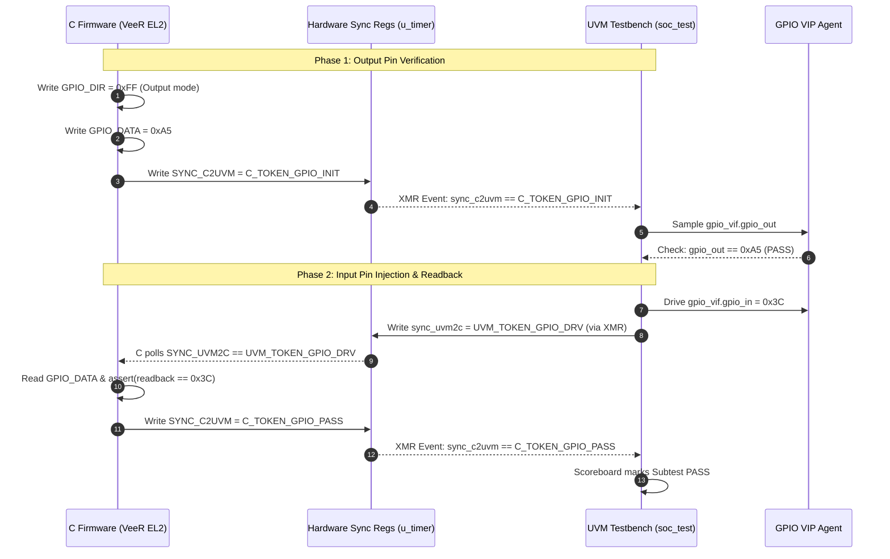

# Honour SoC — Bidirectional C Firmware & UVM Testbench Synchronization Architecture

**Document ID**: `ARCH-VERIF-19`  
**Revision**: `v1.0`  
**Status**: `Approved / Architecture Specification`  
**Target Architecture**: Honour SoC (VeeR EL2 Core + AXI Interconnect + 6 UVM VIPs)  
**Methodology**: IEEE 1800.2 UVM Co-Simulation Synchronized via Dedicated Hardware Mailbox Registers  

---

## 1. Executive Summary & Objective

In modern SoC co-verification, firmware and the testbench must operate in coordinated lockstep:
- **C &rarr; UVM Dependency**: The C test configures an IP, initiates an action, and signals the UVM testbench to inject stimulus or verify boundary pins.
- **UVM &rarr; C Dependency**: The UVM testbench applies external stimulus (e.g. driving GPIO pins, injecting UART commands, or triggering a heartbeat dropout), checks outputs, and signals the C firmware to proceed to the next verification phase.

To achieve this without side effects on functional peripherals, we introduce a **Hardware Mailbox / Synchronization Register Block** into the design that is:
1. **Directly addressable by C firmware** via native AXI4 Memory-Mapped I/O (MMIO).
2. **Directly accessible by UVM** hierarchically via SystemVerilog Cross-Module References (XMR).

```
 +---------------------------------------------------------------------------------------------------+
 |                                         tb_top (UVM Top)                                          |
 |                                                                                                   |
 |  +-------------------------------------+                +--------------------------------------+  |
 |  |          UVM Testbench              |                |               soc_top                |  |
 |  |         (Class Hierarchy)           |                |             (Design RTL)             |  |
 |  |                                     |                |                                      |  |
 |  |   +-----------------------------+   |   Hierarchical |   +------------------------------+   |  |
 |  |   |        soc_test.sv          |   |       XMR      |   |       u_timer (AXI IP)       |   |  |
 |  |   |                             |   |                |   |                              |   |  |
 |  |   |  1. Read C token            |<===== [Read] =======---|   |  sync_c2uvm (Offset 0x04)    |   |  |
 |  |   |     (wait_c_sync(TOKEN))    |   |   (tb_top.     |   |                              |   |  |
 |  |   |                             |   |   u_dut.       |   +------------------------------+   |  |
 |  |   |  2. Drive VIP stimulus      |   |   u_timer.     |                  ^ AXI Writes        |  |
 |  |   |     (GPIO, Heartbeat, UART) |   |   sync_*)      |                  | & Reads           |  |
 |  |   |                             |   |                |                  v                   |  |
 |  |   |  3. Write UVM ack/token     |====== [Write] =====--->|  sync_uvm2c (Offset 0x08)    |   |  |
 |  |   |     (send_uvm_sync(ACK))    |   |                |   +------------------------------+   |  |
 |  |   +-----------------------------+   |                |                  ^                   |  |
 |  |                  |                  |                |                  | Native AXI4       |  |
 |  |                  v                  |                |                  v Bus               |  |
 |  |   +-----------------------------+   |   External     |   +------------------------------+   |  |
 |  |   |    VIP Drivers/Monitors     |===|== Boundary ===>|   |      VeeR EL2 CPU Core       |   |  |
 |  |   | (gpio_vif, heartbeat_vif)   |   |     Pins       |   |                              |   |  |
 |  |   +-----------------------------+   |                |   |  C Firmware:                 |   |  |
 |  |                                     |                |   |    1. Write SYNC_C2UVM = TOK |   |  |
 |  |                                     |                |   |    2. Wait SYNC_UVM2C == ACK |   |  |
 |  +-------------------------------------+                +--------------------------------------+  |
 +---------------------------------------------------------------------------------------------------+
```

---

## 2. Hardware Architecture: Synchronization Registers

We designate **Slave 1 (`u_timer` at Base `0x0002_0100`)** as the host for the synchronization registers. `u_timer` is already allocated a `256-byte` address window (`0x0002_0100` to `0x0002_01FF`) in the AXI interconnect, but currently only uses offset `0x00`.

### Register Address Map

| Offset | Register Name | Width | Access (C) | Access (UVM) | Description |
| :---: | :--- | :---: | :---: | :---: | :--- |
| `0x00` | `TMR_CTR` | 32 | RO | RO | System cycle counter (existing) |
| `0x04` | `SYNC_C2UVM` | 32 | R/W | RO / XMR | **C &rarr; UVM Handshake Register**: C firmware writes phase/status tokens; UVM monitors via XMR |
| `0x08` | `SYNC_UVM2C` | 32 | R/W | R/W / XMR | **UVM &rarr; C Handshake Register**: UVM writes stimulus/completion tokens; C firmware polls via MMIO |
| `0x0C` | `SYNC_SCRATCH` | 32 | R/W | R/W / XMR | Shared bidirectional scratchpad register for passing data payloads |

### Hierarchical XMR Path
In the testbench, UVM accesses these registers directly via:
```systemverilog
tb_top.u_dut.u_timer.sync_c2uvm   // [31:0] C-to-UVM token
tb_top.u_dut.u_timer.sync_uvm2c   // [31:0] UVM-to-C token
```

---

## 3. Handshake Token Protocol

We define structured 32-bit tokens to make co-verification stages unambiguous and traceable:

```
[31:24] Subsystem ID   |   [23:16] Direction   |   [15:0] Phase / Command
```

### Predefined System Tokens
```c
// Direction Flags
#define SYNC_DIR_C2UVM       0x01000000
#define SYNC_DIR_UVM2C       0x02000000

// Generic Tokens
#define SYNC_TOKEN_IDLE      0x00000000
#define SYNC_TOKEN_READY     0x00000001
#define SYNC_TOKEN_ACK       0x00000002
#define SYNC_TOKEN_DONE      0x0000000F

// Subsystem Phase Tokens (Example: GPIO Subtest)
#define C_TOKEN_GPIO_INIT    0x02010010  // C: "GPIO configured as output, wrote 0xA5"
#define UVM_TOKEN_GPIO_DRV   0x02020020  // UVM: "GPIO input driven to 0x3C by VIP"
#define C_TOKEN_GPIO_PASS    0x02010030  // C: "GPIO readback matches 0x3C, phase complete"

// Subsystem Phase Tokens (Example: Heartbeat Dropout Subtest)
#define C_TOKEN_HB_START     0x03010010  // C: "Heartbeat monitor enabled, threshold set"
#define UVM_TOKEN_HB_BURST   0x03020020  // UVM: "VIP generated 10 valid pulses"
#define UVM_TOKEN_HB_DROP    0x03020030  // UVM: "VIP injected dropout/silence"
#define C_TOKEN_HB_TIMEOUT   0x03010040  // C: "CPU detected timeout IRQ/flag"
```

---

## 4. Co-Verification Flow Scenarios

### Scenario A: Closed-Loop GPIO Verification


### Scenario B: Dynamic Heartbeat Failure & Host Reset Recovery
1. **C Firmware**: Configures `HB_THRESHOLD = 500` clock cycles, sets `HB_CTRL = 0x01` (enable), and writes `SYNC_C2UVM = C_TOKEN_HB_START`.
2. **UVM Testbench**:
   - Detects `sync_c2uvm == C_TOKEN_HB_START`.
   - `heartbeat_driver` pulses `heartbeat_in` for 10 periods (healthy operation).
   - `heartbeat_driver` deliberately stops pulsing (injects heartbeat failure).
3. **Hardware**: `heartbeat_monitor` detects timeout, sets `HB_STATUS[1] = 1`, and requests `reset_sequencer` to assert `reset_out`.
4. **UVM VIP**: `reset_seq_monitor` asserts that `reset_out` drops low for exactly 50 clock cycles.
5. **UVM Testbench**: Writes `SYNC_UVM2C = UVM_TOKEN_HB_RECOVERED`.
6. **C Firmware**: Reads `SYNC_UVM2C`, verifies recovery event in `axi_recovery_policy`, and completes test.

---

## 5. Software & Testbench APIs

### 5.1 C Firmware API ([`firmware/test/test_common.h`](file:///home/student/sriv_183/honour_soc/firmware/test/test_common.h))

```c
// Handshake Register MMIO Pointers
#define SYNC_C2UVM   *(volatile uint32_t*)(TMR_BASE + 0x04)
#define SYNC_UVM2C   *(volatile uint32_t*)(TMR_BASE + 0x08)
#define SYNC_SCRATCH *(volatile uint32_t*)(TMR_BASE + 0x0C)

// Synchronous handshake primitives
static inline void uvm_notify(uint32_t token) {
    SYNC_C2UVM = token;
}

static inline void uvm_wait(uint32_t expected_token) {
    uint32_t timeout = WATCHDOG_TIMEOUT;
    while (SYNC_UVM2C != expected_token && --timeout);
    if (!timeout) {
        uart_print("ERROR: Timeout waiting for UVM token: ");
        uart_print_hex(expected_token);
        uart_print("\n");
    }
}

static inline void uvm_handshake(uint32_t send_token, uint32_t wait_token) {
    uvm_notify(send_token);
    uvm_wait(wait_token);
}
```

### 5.2 UVM Testbench Synchronization Methods ([`soc_top_uvm_tb/soc_test.sv`](file:///home/student/sriv_183/honour_soc/soc_top_uvm_tb/soc_test.sv))

```systemverilog
class soc_test extends uvm_test;
  ...
  // Wait for C firmware to signal a milestone via XMR
  task wait_c_token(input bit [31:0] expected_token, input int timeout_cycles = 1000000);
    int count = 0;
    while (tb_top.u_dut.u_timer.sync_c2uvm !== expected_token && count < timeout_cycles) begin
      @(posedge tb_top.clk);
      count++;
    end
    if (count >= timeout_cycles) begin
      `uvm_fatal("SYNC_TIMEOUT", $sformatf("Timeout waiting for C token 0x%08h", expected_token))
    end
    `uvm_info("C_SYNC", $sformatf("Received expected C token: 0x%08h", expected_token), UVM_LOW)
  endtask

  // Signal C firmware to unblock or proceed
  task send_uvm_token(input bit [31:0] token);
    @(posedge tb_top.clk);
    tb_top.u_dut.u_timer.sync_uvm2c = token;
    `uvm_info("UVM_SYNC", $sformatf("Sent UVM token to C: 0x%08h", token), UVM_LOW)
  endtask
endclass
```

---

## 6. Implementation Roadmap

```
+------------------------------------------------------------------------------------+
| Phase 1: RTL Hardware Register Extension (`rtl/custom_ips/axi_timer.v`)           |
|   - Add `sync_c2uvm`, `sync_uvm2c`, and `sync_scratch` registers.                  |
|   - Implement AXI4 read decode for offsets 0x04, 0x08, 0x0C.                       |
|   - Implement AXI4 write decode for offsets 0x04, 0x08, 0x0C.                      |
+------------------------------------------------------------------------------------+
                                         |
                                         v
+------------------------------------------------------------------------------------+
| Phase 2: Firmware Header Primitives (`firmware/test/test_common.h`)                |
|   - Add register definitions and structured token macros.                          |
|   - Implement `uvm_notify()`, `uvm_wait()`, and `uvm_handshake()` functions.       |
+------------------------------------------------------------------------------------+
                                         |
                                         v
+------------------------------------------------------------------------------------+
| Phase 3: UVM Test Coordination (`soc_top_uvm_tb/soc_test.sv`)                      |
|   - Implement XMR monitoring tasks (`wait_c_token`, `send_uvm_token`).             |
|   - Replace static simulation delays (`#3000000`) with dynamic event handshakes.   |
|   - Drop UVM test objection only after C reaches `C_TOKEN_ALL_PASS`.               |
+------------------------------------------------------------------------------------+
                                         |
                                         v
+------------------------------------------------------------------------------------+
| Phase 4: Co-Verification Test Suite (`firmware/test/test_uvm_co_verif.c`)         |
|   - Implement closed-loop tests: GPIO input/output, Heartbeat dropout, Timer sync. |
|   - Connect scoreboard to verify exact match between C assertions and UVM monitors.|
+------------------------------------------------------------------------------------+
                                         |
                                         v
+------------------------------------------------------------------------------------+
| Phase 5: Verification & Waveform Inspection                                        |
|   - Compile and execute via `make sim_uvm`.                                        |
|   - Inspect `sync_c2uvm` and `sync_uvm2c` waveforms in Verdi.                      |
+------------------------------------------------------------------------------------+
```

---

## 7. Verification Impact & Benefits

1. **Deterministic Execution**: Replaces arbitrary `#delay` cycles with exact hardware-synchronized handshakes.
2. **Dynamic Objection Control**: UVM finishes immediately when C test completes, speeding up regressions.
3. **Closed-Loop Pin Testing**: Guarantees external VIP stimuli are injected at the exact clock cycle the firmware is listening.
4. **Zero Silicon Overhead in Tapeout**: The registers can either remain as useful software scratchpads/mailboxes or be synthesized conditionally under `ifdef SIMULATION`.
